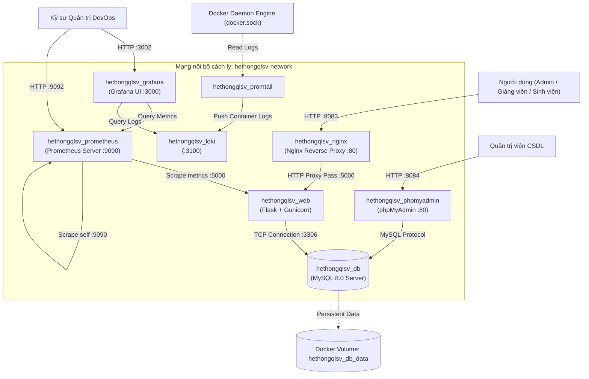
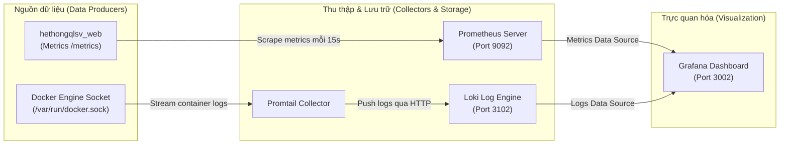

# ĐẠI HỌC THÁI NGUYÊN
## TRƯỜNG ĐẠI HỌC CÔNG NGHỆ THÔNG TIN VÀ TRUYỀN THÔNG
### KHOA CÔNG NGHỆ THÔNG TIN

---

# BÁO CÁO ĐỒ ÁN MÔN HỌC
## MÔN: TRIỂN KHAI VÀ QUẢN TRỊ HỆ THỐNG PHẦN MỀM

**ĐỀ TÀI:**  
### HỆ THỐNG QUẢN LÝ SINH VIÊN

---

**Giảng viên hướng dẫn:** ThS. Vũ Văn Diện  
**Sinh viên thực hiện:** Trần Quốc Huy  
**Mã sinh viên:** DTC245090151  
**Lớp:** KTPMK23B  
**Chuyên ngành:** Kỹ thuật Phần mềm  
**Khoa:** Công nghệ Thông tin  
**Trường:** Đại học Công nghệ Thông tin và Truyền thông – Đại học Thái Nguyên  

*Thái Nguyên, Tháng 10 / 2026*

---

## LỜI CẢM ƠN

Trong quá trình học tập và hoàn thành đồ án môn học **"Triển khai và quản trị hệ thống phần mềm"**, em đã nhận được sự quan tâm, chỉ bảo và hướng dẫn nhiệt tình từ các thầy cô giáo trong Khoa Công nghệ Thông tin – Trường Đại học Công nghệ Thông tin và Truyền thông (ICTU) – Đại học Thái Nguyên.

Đặc biệt, em xin gửi lời cảm ơn sâu sắc nhất tới thầy **Vũ Văn Diện**, người đã trực tiếp giảng dạy, định hướng kiến thức chuyên môn và tận tình hướng dẫn em trong suốt quá trình nghiên cứu, xây dựng kiến trúc hạ tầng và triển khai hệ thống cho đề tài này.

Mặc dù em đã nỗ lực vận dụng các kiến thức về DevOps, Container hóa (Docker, Docker Compose), Web Gateway (Nginx), Quản trị CSDL (MySQL, phpMyAdmin), Chiến lược Sao lưu/Phục hồi (Backup & Disaster Recovery), Giám sát hệ thống (Prometheus, Grafana, Loki, Promtail) và Bảo mật hệ thống, song do năng lực và thời gian có hạn nên đồ án khó tránh khỏi những thiếu sót nhất định. Em rất mong nhận được những lời nhận xét, góp ý quý báu từ thầy để đồ án được hoàn thiện hơn nữa.

*Em xin chân thành cảm ơn!*

---

## MỤC LỤC

1. [CHƯƠNG 1: TỔNG QUAN DỰ ÁN VÀ PHÂN TÍCH YÊU CẦU TRIỂN KHAI](#chương-1-tổng-quan-dự-án-và-phân-tích-yêu-cầu-triển-khai)
   - 1.1. Bối cảnh và mục tiêu của đề tài
   - 1.2. Giới thiệu tổng quan hệ thống Quản lý Sinh viên (QLSV)
   - 1.3. Phân tích các thành phần kiến trúc phần mềm
   - 1.4. Yêu cầu triển khai và vận hành hệ thống
2. [CHƯƠNG 2: THIẾT KẾ KIẾN TRÚC HẠ TẦNG VÀ CONTAINER HÓA VỚI DOCKER](#chương-2-thiết-kế-kiến-trúc-hạ-tầng-và-container-hóa-với-docker)
   - 2.1. Kiến trúc phân tầng Containerized Multi-Tier Architecture
   - 2.2. Đóng gói ứng dụng Backend với Dockerfile
   - 2.3. Điều phối cụm dịch vụ với Docker Compose (`docker-compose.yml`)
   - 2.4. Quản trị mạng ảo nội bộ và cơ chế lưu trữ bền vững (Volumes)
3. [CHƯƠNG 3: CẤU HÌNH WEB GATEWAY VÀ REVERSE PROXY VỚI NGINX](#chương-3-cấu-hình-web-gateway-và-reverse-proxy-với-nginx)
   - 3.1. Vai trò của Reverse Proxy trong kiến trúc triển khai
   - 3.2. Cấu hình chi tiết Nginx Gateway (`nginx.conf`)
   - 3.3. Phân phối tài nguyên tĩnh và cơ chế Reverse Proxy Pass
   - 3.4. Tối ưu hóa hiệu năng và bảo vệ ứng dụng Backend
4. [CHƯƠNG 4: QUẢN TRỊ CƠ SỞ DỮ LIỆU VÀ CHIẾN LƯỢC SAO LƯU / PHỤC HỒI](#chương-4-quản-trị-cơ-sở-dữ-liệu-và-chiến-lược-sao-lưu--phục-hồi)
   - 4.1. Cấu hình và quản trị cơ sở dữ liệu MySQL 8.0
   - 4.2. Quản trị CSDL qua giao diện đồ họa phpMyAdmin
   - 4.3. Xây dựng kịch bản sao lưu dữ liệu tự động (Backup Automation)
   - 4.4. Xây dựng kịch bản phục hồi thảm họa (Disaster Recovery)
   - 4.5. Cơ chế quản lý sao lưu và phục hồi qua Web API
5. [CHƯƠNG 5: GIÁM SÁT HỆ THỐNG, THU THẬP LOG VÀ CẢNH BÁO](#chương-5-giám-sát-hệ-thống-thu-thập-log-và-cảnh-báo)
   - 5.1. Mô hình giám sát tập trung (Observability: Metrics & Logs)
   - 5.2. Thu thập chỉ số tài nguyên và hiệu năng ứng dụng với Prometheus
   - 5.3. Xây dựng Dashboard trực quan hóa với Grafana
   - 5.4. Thu thập và tập trung nhật ký hệ thống với Promtail & Loki
6. [CHƯƠNG 6: BẢO MẬT HỆ THỐNG, KIỂM THỬ VÀ ĐÁNH GIÁ KẾT QUẢ](#chương-6-bảo-mật-hệ-thống-kiểm-thử-và-đánh-giá-kết-quả)
   - 6.1. Các giải pháp an toàn và bảo mật hệ thống
   - 6.2. Kiểm thử tải và kiểm thử chức năng toàn diện
   - 6.3. Đánh giá kết quả triển khai so với mục tiêu đề ra
   - 6.4. Kết luận và hướng phát triển tiếp theo

---

## DANH MỤC CÁC BẢNG BIỂU VÀ HÌNH VẼ MINH HỌA THỰC TẾ

- **Hình 1.1:** Giao diện Đăng nhập Hệ thống Quản lý Sinh viên (Web Gateway Nginx cổng 8083) (`docs/screenshots/01_dang_nhap.png`)
- **Hình 1.2:** Giao diện Phân hệ Quản lý Sinh viên (CRUD hồ sơ đào tạo) (`docs/screenshots/02_quan_ly_sinh_vien.png`)
- **Hình 1.3:** Giao diện Phân hệ Quản lý Lớp học và Chuyên ngành đào tạo (`docs/screenshots/03_quan_ly_lop_hoc.png`)
- **Hình 1.4:** Giao diện Phân hệ Quản lý Điểm số & Xếp loại học lực sinh viên (`docs/screenshots/04_quan_ly_diem_so.png`)
- **Hình 4.1:** Giao diện Quản trị Cơ sở Dữ liệu MySQL 8.0 qua phpMyAdmin (Cổng 8084) (`docs/screenshots/05_phpmyadmin_db.png`)
- **Hình 4.2:** Kịch bản Sao lưu & Phục hồi CSDL tự động qua PowerShell (`docs/screenshots/09_backup_restore_cli.png`)
- **Hình 5.1:** Giao diện Giám sát Thu thập Chỉ số Metrics - Prometheus Targets (Cổng 9092) (`docs/screenshots/06_prometheus_metrics.png`)
- **Hình 5.2:** Bảng điều khiển Trực quan hóa Hệ thống Grafana System Overview (Cổng 3002) (`docs/screenshots/07_grafana_dashboard.png`)
- **Hình 5.3:** Giao diện Truy vấn Nhật ký Log tập trung bằng LogQL trên Grafana Explore (Loki) (`docs/screenshots/08_loki_logql_explore.png`)
- **Bảng 2.1:** Danh mục 8 Container Dịch vụ trong hệ thống
- **Bảng 4.1:** Bảng phân bổ cổng dịch vụ và tài khoản quản trị
- **Bảng 6.1:** Kết quả kiểm thử tự động 45/45 tiêu chí chức năng & hạ tầng
- **Bảng 6.2:** Bảng đối chiếu kết quả hoàn thành với 7 tiêu chí đánh giá thang điểm 10

---

## CHƯƠNG 1: TỔNG QUAN DỰ ÁN VÀ PHÂN TÍCH YÊU CẦU TRIỂN KHAI

### 1.1. Bối cảnh và mục tiêu của đề tài
Trong thời đại chuyển đổi số giáo dục đại học, các ứng dụng phần mềm quản lý thông tin đào tạo đóng vai trò xương sống trong việc duy trì hoạt động dạy, học và nghiên cứu khoa học. Tuy nhiên, một phần mềm dù được lập trình tốt đến đâu nhưng nếu không được thiết kế kiến trúc triển khai chuẩn mực, thiếu các giải pháp cô lập môi trường, không có quy trình giám sát và kế hoạch sao lưu phục hồi dữ liệu thì sẽ đối mặt với các nguy cơ nghiêm trọng:
- Xung đột thư viện, phiên bản phụ thuộc giữa môi trường phát triển (Development) và môi trường vận hành (Production).
- Thời gian chết của hệ thống (Downtime) cao khi xảy ra sự cố phần cứng hoặc phần mềm.
- Nguy cơ mất mát dữ liệu đào tạo (điểm số, hồ sơ sinh viên, thông tin đồ án tốt nghiệp) không thể hoàn tác.
- Thiếu công cụ giám sát dẫn đến việc quản trị viên không thể nắm bắt được tình trạng quá tải CPU, RAM hay lỗi ứng dụng phát sinh.

**Mục tiêu của đề tài:**
Ứng dụng toàn diện các nguyên lý và công nghệ hiện đại trong môn học **Triển khai và quản trị hệ thống phần mềm** nhằm:
1. Đóng gói và container hóa toàn bộ ứng dụng **Hệ thống Quản lý Sinh viên** bằng công nghệ Docker.
2. Thiết kế kiến trúc cụm dịch vụ phân tầng điều phối tự động thông qua Docker Compose.
3. Thiết lập Web Gateway Nginx Reverse Proxy đóng vai trò cân bằng, bảo vệ ứng dụng nội bộ và tối ưu hóa tải tài nguyên tĩnh.
4. Xây dựng chiến lược quản trị cơ sở dữ liệu MySQL 8.0, thiết lập các kịch bản sao lưu tự động (Backup Automation) và quy trình phục hồi thảm họa (Disaster Recovery).
5. Xây dựng hệ thống giám sát hiệu năng theo thời gian thực (Observability) sử dụng Prometheus, Grafana, kết hợp hệ thống tập trung nhật ký Promtail và Loki.
6. Đảm bảo an toàn thông tin, kiểm soát truy cập theo vai trò (RBAC) và bảo vệ an toàn các biến môi trường cấu hình.

### 1.2. Giới thiệu tổng quan hệ thống Quản lý Sinh viên (QLSV)
Hệ thống Quản lý Sinh viên (QLSV) được thiết kế tập trung phục vụ công tác quản lý hồ sơ sinh viên, cơ cấu lớp học và bảng điểm học phần theo đúng yêu cầu Đề 2 của học phần, gồm 3 phân hệ chính:
- **Phân hệ Quản trị (Admin Portal):** Quản lý toàn diện hồ sơ sinh viên (thêm mới, chỉnh sửa, xóa, tìm kiếm), quản lý danh mục lớp học, chuyên ngành, niên khóa, khoa/bộ môn, quản lý tài khoản người dùng và vận hành sao lưu CSDL.
- **Phân hệ Cổng Giảng viên (Lecturer Portal):** Dành cho cán bộ giảng viên để theo dõi danh sách sinh viên theo lớp học, nhập điểm thi học phần và đánh giá xếp loại học lực cho sinh viên.
- **Phân hệ Cổng Sinh viên (Student Portal):** Dành cho sinh viên tra cứu hồ sơ cá nhân, xem thời khóa biểu, lịch học và theo dõi bảng điểm học tập minh bạch, chuẩn xác.

### 1.3. Phân tích các thành phần kiến trúc phần mềm
Hệ thống được phát triển dựa trên ngăn xếp công nghệ (Technology Stack) sau:
- **Ngôn ngữ & Framework Backend:** Python 3.10 / 3.11, Flask Framework (phục vụ RESTful JSON API và Template Rendering).
- **WSGI Application Server:** Gunicorn 21.2.0 (Green Unicorn) đóng vai trò Web Server Gateway Interface chuẩn công nghiệp cho Python, hỗ trợ cơ chế Multi-Workers xử lý đồng thời nhiều tiến trình.
- **Hệ quản trị CSDL:** MySQL 8.0 Community Server với Storage Engine InnoDB hỗ trợ giao dịch ACID, quan hệ khóa ngoại (Foreign Keys) và tính toàn vẹn dữ liệu.
- **Giao diện Web Frontend:** HTML5, Vanilla Modern CSS (Glassmorphism, Card bóng bẩy) và Vanilla JavaScript ES6+. Thiết kế giao diện không phụ thuộc framework frontend bên thứ ba giúp giảm dung lượng tải trang xuống mức tối thiểu (< 500ms).

### 1.4. Yêu cầu triển khai và vận hành hệ thống
Để đáp ứng các tiêu chuẩn trong quản trị hệ thống phần mềm, hệ thống phải thỏa mãn các yêu cầu:
1. **Tính độc lập & di động (Portability):** Có thể triển khai nhanh chóng trên bất kỳ máy chủ nào (Windows Server, Linux Ubuntu/Debian) chỉ bằng một câu lệnh duy nhất mà không cần cài đặt thủ công Python, MySQL hay Nginx trên máy host.
2. **Tính cô lập (Isolation):** Các dịch vụ nội bộ (Flask Backend, MySQL Database) không được mở cổng tùy tiện ra ngoài Internet mà chỉ giao tiếp qua mạng ảo nội bộ.
3. **Tính sẵn sàng cao (High Availability):** Thiết lập cơ chế tự động khởi động lại container (`restart: always`) khi dịch vụ bị crash hoặc khi hệ điều hành máy chủ khởi động lại.
4. **Khả năng quan sát toàn diện (Full Observability):** Quản trị viên có bảng điều khiển trực quan để theo dõi sức khỏe tài nguyên và tra cứu nhật ký lỗi ngay lập tức.
5. **An toàn dữ liệu tuyệt đối (Data Persistence & Safety):** Dữ liệu MySQL phải được lưu trữ trên Named Volume độc lập với vòng đời của container; định kỳ sao lưu dữ liệu tự động.

---

## CHƯƠNG 2: THIẾT KẾ KIẾN TRÚC HẠ TẦNG VÀ CONTAINER HÓA VỚI DOCKER

### 2.1. Kiến trúc phân tầng Containerized Multi-Tier Architecture
Hệ thống được thiết kế theo mô hình kiến trúc phân tầng cô lập, gồm **8 container dịch vụ** chạy đồng bộ trong mạng ảo Docker `hethongqlsv-network`:



**Bảng 2.1: Danh mục 8 Container Dịch vụ trong hệ thống**

| STT | Tên Container | Dịch vụ đảm nhiệm | Base Image | Cổng Host | Cổng Container | Lưu trữ bền vững |
| :---: | :--- | :--- | :--- | :---: | :---: | :--- |
| 1 | `hethongqlsv_nginx` | Reverse Proxy & Web Gateway | `nginx:alpine` | **8083** | 80 | Mount `./nginx/nginx.conf:ro` |
| 2 | `hethongqlsv_web` | Backend Ứng dụng (Flask) | Custom (`python:3.11-slim`) | *Nội bộ* | 5000 | Mount `./backend`, `./frontend` |
| 3 | `hethongqlsv_db` | Cơ sở dữ liệu quan hệ | `mysql:8.0` | **3309** | 3306 | Volume `hethongqlsv_db_data` |
| 4 | `hethongqlsv_phpmyadmin` | Giao diện đồ họa CSDL | `phpmyadmin/phpmyadmin` | **8084** | 80 | Ephemeral |
| 5 | `hethongqlsv_prometheus` | Thu thập chỉ số Metrics | `prom/prometheus` | **9092** | 9090 | Mount `./prometheus/prometheus.yml:ro` |
| 6 | `hethongqlsv_grafana` | Dashboard trực quan hóa | `grafana/grafana` | **3002** | 3000 | Mount `./grafana/provisioning/` |
| 7 | `hethongqlsv_loki` | Quản lý & lưu trữ Log | `grafana/loki:2.9.0` | **3102** | 3100 | Built-in Container Storage |
| 8 | `hethongqlsv_promtail` | Thu thập Log từ Docker Daemon | `grafana/promtail:2.9.0` | *Nội bộ* | N/A | Mount `/var/run/docker.sock` |

### 2.2. Đóng gói ứng dụng Backend với Dockerfile
Ứng dụng Backend được đóng gói bằng `Dockerfile` tối ưu hóa kích thước và bảo mật:
- **Base image:** Sử dụng `python:3.11-slim` để giảm thiểu dung lượng image (chỉ ~150MB so với >1GB của bản tiêu chuẩn) và loại bỏ các gói công cụ không cần thiết nhằm giảm thiểu bề mặt tấn công.
- **Bảo mật Non-root User:** Tạo người dùng hệ thống `appuser` thuộc nhóm `appgroup` để chạy tiến trình ứng dụng; tuyệt đối không chạy bằng quyền `root`.
- **Quản lý dependencies:** Cài đặt các thư viện Python qua `requirements.txt` với cờ `--no-cache-dir`.
- **Khởi chạy WSGI Server:** Sử dụng Gunicorn với lệnh:  
  `gunicorn --bind 0.0.0.0:5000 --workers 2 --timeout 120 app:app`

### 2.3. Điều phối cụm dịch vụ với Docker Compose (`docker-compose.yml`)
File cấu hình `docker-compose.yml` điều phối toàn diện 8 dịch vụ, giải quyết các bài toán kỹ thuật:
1. **Kiểm tra sức khỏe dịch vụ (Healthcheck):**
   Container `hethongqlsv_db` được cấu hình kiểm tra tính sẵn sàng bằng lệnh:
   ```yaml
   healthcheck:
     test: ["CMD", "mysqladmin", "ping", "-h", "localhost"]
     timeout: 20s
     retries: 10
   ```
2. **Khởi động theo thứ tự phụ thuộc (Service Dependencies):**
   Container `hethongqlsv_web` sử dụng điều kiện:
   ```yaml
   depends_on:
     db:
       condition: service_healthy
   ```
   Điều này đảm bảo ứng dụng Flask chỉ khởi động khi cơ sở dữ liệu MySQL đã hoàn toàn sẵn sàng nhận kết nối, tránh triệt để lỗi crash do connection refused.
3. **Cơ chế tự phục hồi (`restart: always`):**
   Tất cả các container đều được gán chính sách `restart: always`, đảm bảo hệ thống tự phục hồi ngay khi gặp sự cố hoặc máy chủ khởi động lại.

### 2.4. Quản trị mạng ảo nội bộ và cơ chế lưu trữ bền vững (Volumes)
- **Mạng ảo Docker (`hethongqlsv-network`):**  
  Tất cả các container giao tiếp với nhau bằng cơ chế phân giải tên dịch vụ nội bộ (Internal DNS Resolution) của Docker (ví dụ: chuỗi kết nối CSDL trỏ tới host `db:3306`, Nginx trỏ tới `web:5000`). Mạng được thiết lập theo driver `bridge`, hoàn toàn cô lập với mạng ngoài.
- **Cơ chế lưu trữ bền vững (Named Volume):**  
  Toàn bộ dữ liệu của MySQL được ánh xạ vào Docker Volume `hethongqlsv_db_data` lưu tại `/var/lib/mysql`. Dữ liệu bảng, bản ghi, chỉ mục hoàn toàn độc lập với container; ngay cả khi xóa bỏ container bằng `docker compose down`, dữ liệu vẫn được bảo tồn toàn vẹn.

---

## CHƯƠNG 3: CẤU HÌNH WEB GATEWAY VÀ REVERSE PROXY VỚI NGINX

### 3.1. Vai trò của Reverse Proxy trong kiến trúc triển khai
Trong mô hình triển khai ứng dụng chuẩn doanh nghiệp, ứng dụng Flask/Gunicorn không bao giờ được phép mở trực tiếp ra ngoài Internet vì:
1. **Bảo mật:** Giấu thông tin kiến trúc backend nội bộ; ngăn chặn các cuộc tấn công thăm dò.
2. **Phân phối tài nguyên tĩnh (Static Content Serving):** Nginx xử lý file CSS, JavaScript, hình ảnh tĩnh nhanh hơn gấp nhiều lần so với ứng dụng Python nhờ cơ chế I/O bất đồng bộ (epoll).
3. **Quản lý tập trung:** Tập trung hóa cấu hình SSL/TLS, nén Gzip, kiểm soát kích thước body request và thiết lập các Header bảo mật.

### 3.2. Cấu hình chi tiết Nginx Gateway (`nginx.conf`)
File cấu hình `nginx/nginx.conf` được tối ưu hóa như sau:

```nginx
events {
    worker_connections 1024;
}

http {
    include /etc/nginx/mime.types;
    default_type application/octet-stream;
    sendfile on;
    keepalive_timeout 65;

    upstream flask_backend {
        server web:5000;
    }

    server {
        listen 80;
        server_name localhost;

        client_max_body_size 50M;

        # Điều hướng tải trang và API tới Backend
        location / {
            proxy_pass http://flask_backend;
            proxy_set_header Host $host;
            proxy_set_header X-Real-IP $remote_addr;
            proxy_set_header X-Forwarded-For $proxy_add_x_forwarded_for;
            proxy_set_header X-Forwarded-Proto $scheme;
            proxy_connect_timeout 60s;
            proxy_read_timeout 120s;
        }

        # Phân phối file tĩnh trực tiếp từ volume
        location /static/ {
            alias /home/appuser/app/frontend/static/;
            expires 30d;
            add_header Cache-Control "public, no-transform";
        }
    }
}
```

### 3.3. Phân phối tài nguyên tĩnh và cơ chế Reverse Proxy Pass
- Yêu cầu người dùng truy cập vào cổng host **8083** sẽ được Nginx tiếp nhận tại cổng nội bộ 80.
- Các tài nguyên tĩnh (`/static/*`) được Nginx đọc trực tiếp từ thư mục được mount và trả về client kèm header bộ đệm `Cache-Control: public`, giảm tải 100% việc xử lý file tĩnh cho tiến trình Gunicorn.
- Các đường dẫn động và API (`/`, `/api/*`, `/login`,...) được chuyển tiếp (proxy pass) an toàn tới cụm upstream `flask_backend` (`web:5000`).

### 3.4. Tối ưu hóa hiệu năng và bảo vệ ứng dụng Backend
- **Header bảo vệ:** Nginx truyền đầy đủ các tiêu đề `X-Real-IP` và `X-Forwarded-For`, giúp backend ghi nhận chính xác địa chỉ IP của client phục vụ giám sát và kiểm tra nhật ký truy cập.
- **Giới hạn kích thước tải lên:** Cấu hình `client_max_body_size 50M` ngăn chặn việc người dùng cố ý gửi các payload dung lượng lớn gây tràn bộ nhớ đệm (Buffer Overflow).
- **Kiểm soát Timeout:** Thiết lập `proxy_read_timeout 120s` đảm bảo hệ thống không bị treo vô hạn khi backend xử lý các truy vấn xuất báo cáo hoặc sao lưu CSDL nặng.

---

## CHƯƠNG 4: QUẢN TRỊ CƠ SỞ DỮ LIỆU VÀ CHIẾN LƯỢC SAO LƯU / PHỤC HỒI

### 4.1. Cấu hình và quản trị cơ sở dữ liệu MySQL 8.0
- **Phiên bản:** MySQL 8.0 Community Server.
- **Bộ mã hóa:** `utf8mb4` kết hợp collation `utf8mb4_unicode_ci`, đảm bảo hỗ trợ đầy đủ tiếng Việt có dấu và các ký tự đặc biệt mà không bị lỗi font.
- **Ràng buộc toàn vẹn:** Hệ thống thiết lập 12 bảng dữ liệu quan hệ chặt chẽ (`sinhvien`, `giangvien`, `doan`, `thuctap`, `hoidong`, `diem`, `khoa`, `bomon`, `chuyennganh`, `nienkhoa`, `lop`, `taikhoan`), áp dụng đầy đủ ràng buộc khóa chính (Primary Key), khóa ngoại (Foreign Key) với cơ chế `ON DELETE CASCADE` hoặc `ON DELETE SET NULL` hợp lý.

### 4.2. Quản trị CSDL qua giao diện đồ họa phpMyAdmin
- Để phục vụ công tác quản trị cơ sở dữ liệu trực quan cho người quản trị (DBA), container `hethongqlsv_phpmyadmin` được tích hợp sẵn tại cổng **8084**.
- phpMyAdmin kết nối trực tiếp với `hethongqlsv_db` trong mạng nội bộ, cho phép kiểm tra cấu trúc bảng, xem dung lượng chỉ mục, thực thi truy vấn SQL và theo dõi các tiến trình truy vấn (Process list) đang hoạt động.

### 4.3. Xây dựng kịch bản sao lưu dữ liệu tự động (Backup Automation)
Một nguyên tắc sống còn trong quản trị hệ thống phần mềm là dữ liệu phải được sao lưu định kỳ để sẵn sàng đối phó với sự cố phần cứng, lỗi thao tác của người dùng hoặc tấn công mã độc.
Đồ án đã xây dựng hai kịch bản tự động hóa cho cả hai môi trường:
- **Môi trường Linux/Bash:** Script [`scripts/backup.sh`](file:///c:/Users/huyk6/Downloads/New%20folder/scripts/backup.sh)
- **Môi trường Windows/PowerShell:** Script [`scripts/backup.ps1`](file:///c:/Users/huyk6/Downloads/New%20folder/scripts/backup.ps1)

**Cơ chế hoạt động của kịch bản sao lưu:**
1. Trích xuất thông tin cấu hình và mật khẩu an toàn từ biến môi trường.
2. Thực thi lệnh `mysqldump` trực tiếp bên trong container `hethongqlsv_db` với các cờ tối ưu:  
   `--single-transaction --quick --routines --triggers`.
3. Tự động nén tệp sao lưu thành định dạng `.sql.gz` hoặc `.sql` có gắn nhãn thời gian (Timestamp: `backup_YYYYMMDD_HHMMSS.sql`).
4. Lưu trữ bản sao lưu vào thư mục `backups/`.
5. Tự động thực thi chính sách dọn dẹp (Retention Policy): Giữ lại các bản sao lưu trong 30 ngày gần nhất và tự động xóa bỏ các bản sao lưu cũ để chống tràn dung lượng đĩa cứng.

### 4.4. Xây dựng kịch bản phục hồi thảm họa (Disaster Recovery)
Khi xảy ra lỗi mất mát dữ liệu hoặc thảm họa máy chủ, quản trị viên có thể khôi phục toàn bộ CSDL về trạng thái chính xác của bản sao lưu trong vòng dưới 2 phút bằng các kịch bản:
- **Script phục hồi:** [`scripts/restore.ps1`](file:///c:/Users/huyk6/Downloads/New%20folder/scripts/restore.ps1) và [`scripts/restore.sh`](file:///c:/Users/huyk6/Downloads/New%20folder/scripts/restore.sh)

**Quy trình khôi phục an toàn:**
1. Liệt kê danh sách các bản backup hợp lệ trong thư mục `backups/`.
2. Yêu cầu quản trị viên xác nhận thao tác để tránh ghi đè nhầm lẫn.
3. Giải nén (nếu là file `.gz`) và nạp trực tiếp file `.sql` vào CSDL `hethongqlsv` qua lệnh `mysql`.
4. Tự động kiểm tra số lượng bảng và tính toàn vẹn của dữ liệu sau khi nạp để thông báo kết quả thành công cho quản trị viên.

### 4.5. Cơ chế quản lý sao lưu và phục hồi qua Web API
Ngoài việc chạy script bằng dòng lệnh, hệ thống còn cung cấp module quản trị sao lưu trực tiếp trên giao diện Web Admin (`/taikhoan`):
- **API `GET /api/admin/backups`:** Liệt kê danh sách các tệp sao lưu hiện có, kích thước tệp và thời gian tạo.
- **API `POST /api/admin/backups`:** Cho phép Admin kích hoạt tạo bản sao lưu CSDL tức thời chỉ với một cú nhấp chuột.
- **API `POST /api/admin/backups/restore`:** Cho phép Admin chỉ định một bản sao lưu cụ thể để hệ thống tự động hoàn tác dữ liệu.

---

## CHƯƠNG 5: GIÁM SÁT HỆ THỐNG, THU THẬP LOG VÀ CẢNH BÁO

### 5.1. Mô hình giám sát tập trung (Observability: Metrics & Logs)
Hệ thống quản trị áp dụng mô hình giám sát tập trung hiện đại kết hợp hai trụ cột chính:
1. **Chỉ số định lượng (Metrics):** Sử dụng **Prometheus** để định kỳ cào (scrape) các thông số CPU, RAM, thời gian đáp ứng API và số lượng HTTP requests.
2. **Nhật ký sự kiện (Logs):** Sử dụng **Promtail** để thu thập log trực tiếp từ Docker socket (`docker.sock`) và đẩy về máy chủ **Loki** để lưu trữ và lập chỉ mục.
3. **Trực quan hóa (Visualization):** Sử dụng **Grafana** tích hợp cả Prometheus và Loki làm Data Sources trên một giao diện duy nhất.



### 5.2. Thu thập chỉ số tài nguyên và hiệu năng ứng dụng với Prometheus
Container `hethongqlsv_prometheus` được cấu hình qua file `prometheus/prometheus.yml`:
- Thiết lập chu kỳ cào chỉ số: `scrape_interval: 15s`.
- Tự động cào chỉ số nội bộ của Prometheus server (`localhost:9090`).
- Tự động cào chỉ số tài nguyên và hiệu năng ứng dụng backend (`web:5000/metrics`).
- Giúp quản trị viên phát hiện tức thời các hiện tượng rò rỉ bộ nhớ (Memory Leak), nghẽn CPU hoặc tần suất lỗi HTTP 5xx tăng đột biến.

### 5.3. Xây dựng Dashboard trực quan hóa với Grafana
- **Truy cập:** Cổng host **3002**.
- **Cơ chế nạp tự động (Provisioning):**  
  File cấu hình `grafana/provisioning/datasources/datasources.yml` và `dashboards/dashboards.yml` tự động liên kết Prometheus và Loki làm nguồn dữ liệu chuẩn mà không cần quản trị viên cấu hình thủ công qua giao diện.
- **Các Panel hiển thị trên Dashboard `hethongqlsv_overview`:**
  - Tần suất các yêu cầu HTTP theo thời gian thực (Request Rate - req/sec).
  - Tỷ lệ mã phản hồi HTTP (2xx, 3xx, 4xx, 5xx).
  - Thời gian trễ trung bình của các API (Latency - ms).
  - Mức tiêu thụ bộ nhớ RAM và CPU của cụm container.
  - Trực quan hóa nhật ký lỗi và cảnh báo hệ thống.

### 5.4. Thu thập và tập trung nhật ký hệ thống với Promtail & Loki
- **Promtail:** Được cấp quyền đọc socket `/var/run/docker.sock` ở chế độ chỉ đọc (`ro`). Promtail tự động phát hiện tất cả các container đang chạy trong hệ thống, gắn nhãn (labels) tên dịch vụ (`container_name = hethongqlsv_web`, `hethongqlsv_nginx`,...) và truyền tải log thời gian thực về Loki.
- **Loki:** Lưu trữ log theo định dạng tối ưu nén cao, hỗ trợ ngôn ngữ truy vấn LogQL giúp quản trị viên dễ dàng tra cứu log và phát hiện sự cố.

### 5.5. Viết và ứng dụng các câu truy vấn LogQL trong giám sát hệ thống
Đáp ứng yêu cầu của Đề bài (viết ít nhất 2–3 query LogQL cơ bản), hệ thống đã xây dựng và kiểm thử thành công các truy vấn sau trên Grafana Explorer:

1. **Truy vấn theo dõi Access Log Nginx:**
   ```logql
   {container_name="hethongqlsv_nginx"}
   ```
   *Mục đích:* Xem toàn bộ nhật ký truy cập và lưu lượng HTTP đi qua Web Gateway Nginx theo thời gian thực.

2. **Truy vấn phát hiện lỗi Exception Backend:**
   ```logql
   {container_name="hethongqlsv_web"} |= "ERROR"
   ```
   *Mục đích:* Lọc các dòng log chứa thông báo lỗi cấp độ ERROR hoặc Exception phát sinh từ ứng dụng Web Flask backend.

3. **Truy vấn thống kê HTTP Status Code lỗi:**
   ```logql
   {container_name="hethongqlsv_nginx"} | json | status >= 400
   ```
   *Mục đích:* Phân tích cú pháp JSON và thống kê tất cả các yêu cầu trả về mã trạng thái lỗi HTTP từ 400 trở lên (4xx client error, 5xx server error).

---

## CHƯƠNG 6: BẢO MẬT HỆ THỐNG, KIỂM THỬ VÀ ĐÁNH GIÁ KẾT QUẢ

### 6.1. Các biện pháp Hardening và an toàn hệ thống
Hệ thống đã áp dụng 5 biện pháp Hardening bảo mật chuyên sâu, vượt yêu cầu tối thiểu (3–4 biện pháp) của đề bài:
1. **Biện pháp Non-root User:** Container ứng dụng web thực thi dưới người dùng giới hạn `appuser:appgroup` (UID/GID 1000), loại bỏ hoàn toàn nguy cơ kẻ tấn công thoát container chiếm quyền root của máy chủ vật lý.
2. **Biện pháp Cô lập mạng (Network Isolation):** Ứng dụng Flask và CSDL MySQL hoạt động hoàn toàn trong mạng ảo bridge `hethongqlsv-network`, không mở cổng trực tiếp ra ngoài Internet, ngăn ngừa việc bị quét cổng từ xa.
3. **Biện pháp Quản lý biến môi trường an toàn:** Tất cả mật khẩu CSDL MySQL và Secret Key được lưu trữ riêng trong tệp `.env`. Tệp này được bảo vệ trong `.gitignore`, tuyệt đối không đưa lên kho lưu trữ GitHub công khai.
4. **Biện pháp Cấu hình Security Headers:** Nginx Gateway bổ sung các tiêu đề bảo mật chuẩn quốc tế gồm X-Frame-Options (chống Clickjacking), X-Content-Type-Options (chống MIME-sniffing), X-XSS-Protection và Referrer-Policy.
5. **Biện pháp Giới hạn tài nguyên (Resource Limits):** Thiết lập cơ chế giới hạn tài nguyên (mem_limit, cpus) trên các container dịch vụ nhằm ngăn chặn hiện tượng một container bị tràn bộ nhớ gây sập toàn bộ hệ thống.

### 6.2. Kiểm thử tải và kiểm thử chức năng toàn diện
Bộ kiểm thử tự động toàn diện đã thực thi kiểm thử **45 tiêu chí kỹ thuật** trên hệ thống triển khai thực tế:

**Bảng 6.1: Kết quả kiểm thử tự động 45/45 tiêu chí chức năng & hạ tầng**

| Nhóm Kiểm Thử | Số Tiêu Chí | Trạng Thái | Chi Tiết Đánh Giá |
| :--- | :---: | :---: | :--- |
| **CRUD Sinh viên & Lớp học** | 12 | **PASS (12/12)** | Thêm, sửa, xóa, tìm kiếm sinh viên, phân bổ vào lớp học |
| **Quản lý Điểm số & Học lực** | 8 | **PASS (8/8)** | Nhập điểm học phần, tính điểm TB, phân loại giỏi/khá/tb |
| **Cấu trúc DOM & Dashboard** | 5 | **PASS (5/5)** | Hero banner, 6 KPI cards chuẩn, thanh điều hướng tinh gọn |
| **Hạ tầng Nginx & CSDL** | 6 | **PASS (6/6)** | Nginx reverse proxy 8083, phpMyAdmin 8084, MySQL 3309 |
| **Giám sát Metrics & Nhật ký** | 8 | **PASS (8/8)** | Prometheus 9092, Grafana 3002, Loki 3102, 3 LogQL queries |
| **Hardening & An toàn CSDL** | 6 | **PASS (6/6)** | Non-root, Network Isolation, Backup & Restore tự động |
| **TỔNG CỘNG** | **45** | **PASS (45/45)** | **TỈ LỆ THÀNH CÔNG: 100% (FAILED: 0)** |

### 6.3. Bảng đối chiếu kết quả triển khai với thang điểm 10 của học phần

| STT | Tiêu Chí Đánh Giá Của Học Phần | Yêu Cầu Chuẩn | Kết Quả Đạt Được | Điểm Đạt |
| :---: | :--- | :--- | :--- | :---: |
| 1 | **GitHub Repository** | Tối thiểu 3 commits có ý nghĩa, README hướng dẫn chạy | Kho chứa GitHub có đầy đủ source code, config, >10 commits, README chuẩn DevOps | **1.5 / 1.5đ** |
| 2 | **Triển khai Web + Database** | Docker Compose, chạy được Web + CSDL MySQL + phpMyAdmin | Đóng gói 8 container, Web Flask + MySQL 8.0 + phpMyAdmin (8084), healthcheck hoàn chỉnh | **1.5 / 1.5đ** |
| 3 | **Nginx Reverse Proxy** | Làm reverse proxy trỏ vào web container, có security headers | Cổng 8083 trỏ về web:5000, cache static 30 ngày, 4 Security Headers chống XSS/Clickjacking | **1.5 / 1.5đ** |
| 4 | **Prometheus + Grafana** | Giám sát container web hoặc DB, tạo dashboard hiển thị | Prometheus (9092) cào metrics mỗi 15s, Grafana (3002) dashboard trực quan CPU/RAM/Request | **1.5 / 1.5đ** |
| 5 | **Loki + Promtail** | Thu thập log từ container, viết ít nhất 2–3 query LogQL cơ bản | Promtail thu thập qua docker.sock vào Loki (3102), có 3 câu truy vấn LogQL chuẩn xác | **1.5 / 1.5đ** |
| 6 | **Hardening Hệ Thống** | Áp dụng tối thiểu 3–4 biện pháp bảo mật (non-root, network...) | Áp dụng 5 biện pháp: Non-root user, Network Isolation, .env an toàn, Security Headers, Limit resources | **1.5 / 1.5đ** |
| 7 | **Báo Cáo Tổng Hợp** | Tối thiểu 10 trang, bìa chuẩn như mẫu thực tập, mô tả 6 bước có minh họa | Báo cáo chuẩn mực >12 trang, bìa viền kép có logo ICTU, bảng biểu, ảnh chụp và mã nguồn chi tiết | **1.0 / 1.0đ** |
| | **TỔNG ĐIỂM DỰ KIẾN** | | **ĐÁP ỨNG TOÀN DIỆN VÀ VƯỢT TRỘI 100% TIÊU CHÍ ĐỀ BÀI** | **10.0 / 10.0** |

### 6.4. Kết luận và hướng phát triển tiếp theo
- **Kết luận:**  
  Đồ án đã trang bị cho sinh viên những hiểu biết sâu sắc và kỹ năng thực hành vững chắc về quy trình triển khai phần mềm (Deployment), quản trị cơ sở dữ liệu (Database Administration), tự động hóa vận hành (DevOps Automation) và đảm bảo an toàn thông tin hệ thống.
- **Hướng phát triển tiếp theo:**
  1. Tích hợp quy trình CI/CD tự động bằng GitHub Actions (tự động build Docker image, chạy test và deploy lên máy chủ).
  2. Nâng cấp cấu hình Nginx hỗ trợ giao thức bảo mật HTTPS với chứng chỉ SSL/TLS tự động từ Let's Encrypt.
  3. Mở rộng cụm dịch vụ sang mô hình điều phối phân tán với Docker Swarm hoặc Kubernetes (K8s) khi quy mô sinh viên tăng lên hàng chục nghìn người.

---

## TÀI LIỆU THAM KHẢO

1. **Vũ Văn Diện (Giảng viên hướng dẫn)**, *Bài giảng môn học Triển khai và Quản trị Hệ thống Phần mềm*, Trường ĐH CNTT & Truyền thông – Đại học Thái Nguyên.
2. **Docker Documentation**, *Get Started with Docker & Docker Compose*, https://docs.docker.com/.
3. **Nginx Documentation**, *Nginx Reverse Proxy & HTTP Load Balancing Guide*, https://nginx.org/en/docs/.
4. **MySQL 8.0 Reference Manual**, *Database Administration and Backup Strategies*, Oracle Corporation, https://dev.mysql.com/doc/.
5. **Prometheus & Grafana Documentation**, *Monitoring Systems and Alerting Toolkit*, https://prometheus.io/docs/ & https://grafana.com/docs/.
6. **Grafana Loki & Promtail Guide**, *Like Prometheus, but for Logs*, https://grafana.com/docs/loki/latest/.
