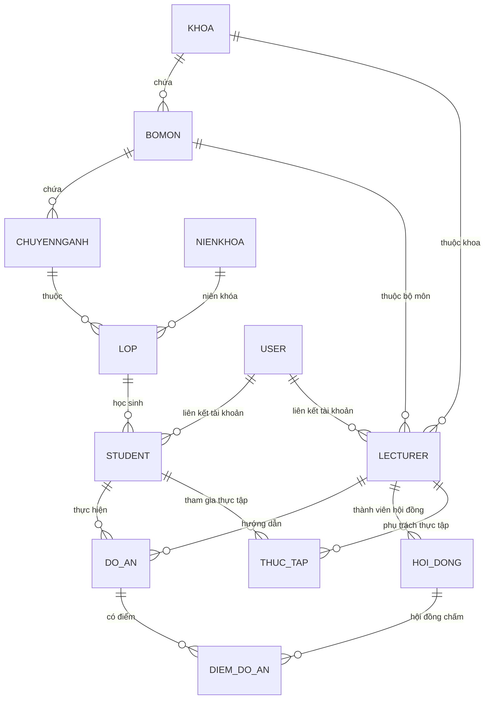

# HƯỚNG DẪN QUẢN TRỊ CƠ SỞ DỮ LIỆU MYSQL
**Môn học:** Triển khai và quản trị hệ thống phần mềm  
**Hệ quản trị CSDL:** MySQL 8.0 Community Server  
**Tên cơ sở dữ liệu:** `student_db`  
**Bảng mã (Charset/Collation):** `utf8mb4` / `utf8mb4_unicode_ci`

---

## 1. Kiến trúc và Cấu trúc Lưu trữ

Cơ sở dữ liệu của hệ thống được quản trị bởi container `hethongqlsv_db` chạy MySQL 8.0. Dữ liệu được lưu trữ bền vững tại:
- **Đường dẫn trong container:** `/var/lib/mysql`
- **Ánh xạ Docker Volume:** `hethongqlsv_db_data` (Managed Named Volume)
- **Cổng giao tiếp nội bộ:** `3306` (dành cho Flask app và phpMyAdmin kết nối qua Docker Network)
- **Cổng giao tiếp bên ngoài:** `3309` (dành cho công cụ quản trị bên ngoài máy host như DBeaver, MySQL Workbench hoặc script backup)

---

## 2. Sơ đồ Quan hệ Thực thể (Entity-Relationship Diagram - ERD)

Hệ thống bao gồm **12 bảng quan hệ** chặt chẽ, được chia thành 3 phân nhóm chức năng:



---

## 3. Danh mục Chi tiết 12 Bảng Dữ liệu và Ràng buộc Toàn vẹn

### 3.1. Phân nhóm Bảng Danh mục Tổ chức (Catalog Hierarchy)
1. **`khoa`**: Quản lý các Khoa đào tạo.
   - Khóa chính (PK): `id` (INT AUTO_INCREMENT).
   - Trường: `ma_khoa` (VARCHAR 20 UNIQUE), `ten_khoa`, `mo_ta`.
2. **`bomon`**: Quản lý Bộ môn trực thuộc Khoa.
   - Khóa ngoại (FK): `khoa_id` tham chiếu `khoa(id)`.
3. **`chuyennganh`**: Quản lý Chuyên ngành đào tạo.
   - Khóa ngoại (FK): `bomon_id` tham chiếu `bomon(id)`.
4. **`nienkhoa`**: Quản lý các khóa học (VD: 2021-2025).
   - Khóa chính (PK): `id`. Trường: `ma_nien_khoa` (UNIQUE), `ten_nien_khoa`.
5. **`lop`**: Lớp sinh hoạt chuyên ngành.
   - Khóa ngoại (FK): `chuyennganh_id` -> `chuyennganh(id)`, `nienkhoa_id` -> `nienkhoa(id)`.

### 3.2. Phân nhóm Thực thể Người và Nghiệp vụ Đào tạo
6. **`student`**: Lưu trữ hồ sơ sinh viên.
   - Khóa chính: `id`.
   - Khóa ngoại: `lop_id` -> `lop(id)`.
   - Trường nghiệp vụ: `ma_sv` (UNIQUE), `ten_sv`, `ngay_sinh`, `gioi_tinh`, `email`, `so_dien_thoai`, `dia_chi`, `trang_thai` (`DangHoc`, `NghiHoc`, `TotNghiep`).
7. **`lecturer`**: Lưu trữ hồ sơ giảng viên.
   - Khóa ngoại: `khoa_id` -> `khoa(id)`, `bomon_id` -> `bomon(id)`.
   - Trường nghiệp vụ: `ma_gv` (UNIQUE), `ten_gv`, `hoc_vi`, `email`, `so_dien_thoai`.
8. **`do_an`**: Quản lý đề tài đồ án tốt nghiệp.
   - Khóa ngoại: `student_id` -> `student(id)`, `lecturer_id` -> `lecturer(id)`.
   - Trường: `ten_do_an`, `trang_thai` (`DangThucHien`, `ChoBaoVe`, `HoanThanh`).
9. **`diem_do_an`**: Điểm đánh giá của Hội đồng chấm đồ án.
   - Khóa ngoại: `do_an_id` -> `do_an(id)`, `hoi_dong_id` -> `hoi_dong(id)`.
   - Ràng buộc: Khi xóa Đồ án, các bản ghi điểm liên quan phải được xử lý để tránh lỗi mồ côi (Orphan records).
10. **`hoi_dong`**: Hội đồng chấm bảo vệ khóa luận.
    - Khóa ngoại: `chu_tich_id` -> `lecturer(id)`, `thu_ky_id` -> `lecturer(id)`, `phan_bien_id` -> `lecturer(id)`.
11. **`thuc_tap`**: Quản lý vị trí thực tập doanh nghiệp.
    - Khóa ngoại: `student_id` -> `student(id)`, `lecturer_id` -> `lecturer(id)`.
    - Trường: `ten_doanh_nghiep`, `dia_chi_doanh_nghiep`, `nguoi_huong_dan`, `diem_thuc_tap`.

### 3.3. Phân nhóm Xác thực và Phân quyền (Security & Accounts)
12. **`user`**: Quản lý tài khoản đăng nhập hệ thống.
    - Khóa chính: `id`.
    - Trường bảo mật:
      - `username` (VARCHAR 80 UNIQUE)
      - `password_hash` (VARCHAR 255)
      - `role` (ENUM / VARCHAR: `QuanTriVien`, `GiangVien`, `SinhVien`)
      - `full_name` (VARCHAR 100 - Đồng bộ họ tên người dùng)
      - `status` (VARCHAR 20: `HoatDong`, `Khoa` - Quản trị vô hiệu hóa tài khoản vi phạm)

---

## 4. Quản trị Tài khoản và Phân quyền Truy cập (Least Privilege Principle)

Trong môn học Triển khai và quản trị hệ thống phần mềm, một nguyên tắc bảo mật cơ bản là **không để ứng dụng web chạy bằng quyền `root` của cơ sở dữ liệu**.

### 4.1. Hiện trạng Môi trường Demo
- Ứng dụng hiện kết nối qua chuỗi kết nối: `mysql+pymysql://root:${DB_PASSWORD}@db:3306/student_db`.
- Cách này thuận tiện cho việc khởi tạo môi trường demo ban đầu, nhưng tiềm ẩn rủi ro trong môi trường production.

### 4.2. Khuyến nghị Phân quyền Tối thiểu khi Triển khai Chính thức (Hardening)
Tạo riêng tài khoản `app_user` chỉ cấp các quyền thao tác dữ liệu (`DML`) cần thiết, không cấp quyền cấu trúc (`DDL`) hoặc quản trị hệ thống (`GRANT`):

```sql
-- 1. Tạo tài khoản riêng cho ứng dụng Flask
CREATE USER 'app_user'@'%' IDENTIFIED BY 'StrongAppPassword123!';

-- 2. Chỉ cấp quyền đọc và ghi dữ liệu trong student_db
GRANT SELECT, INSERT, UPDATE, DELETE ON student_db.* TO 'app_user'@'%';

-- 3. Làm mới bảng đặc quyền
FLUSH PRIVILEGES;
```
Khi đó, cập nhật biến `DATABASE_URL` trong file `.env`:
```text
DATABASE_URL=mysql+pymysql://app_user:StrongAppPassword123!@db:3306/student_db
```

---

## 5. Quy trình Khởi tạo và Đồng bộ Schema (Schema Evolution & Migration)

### 5.1. Giới hạn kỹ thuật của `db.create_all()`
- Hàm `db.create_all()` của SQLAlchemy **chỉ tạo mới các bảng chưa tồn tại**.
- Nếu bảng `user` đã tồn tại từ trước và ta thêm cột `status` hoặc `full_name` vào Python Model, `db.create_all()` **sẽ bỏ qua và không tự động cập nhật bảng MySQL**.
- Hậu quả: Gây ra lỗi `OperationalError: (1054, "Unknown column 'user.status' in 'field list'")`.

### 5.2. Giải pháp Đồng bộ Schema An toàn
Để thêm trường mới mà không làm mất dữ liệu hiện có trong bảng, người quản trị thực hiện quy trình sau:

```sql
-- Kiểm tra cột đã tồn tại chưa
SELECT COLUMN_NAME FROM INFORMATION_SCHEMA.COLUMNS 
WHERE TABLE_SCHEMA = 'student_db' AND TABLE_NAME = 'user' AND COLUMN_NAME = 'status';

-- Bổ sung an toàn nếu chưa có
ALTER TABLE user ADD COLUMN status VARCHAR(20) DEFAULT 'HoatDong';
ALTER TABLE user ADD COLUMN full_name VARCHAR(100) NULL;
```
Hệ thống hiện tại đã được đồng bộ đầy đủ các cột này và xác minh hoạt động trơn tru.

---

## 6. Bảo vệ và Tối ưu hóa Chỉ mục (Index Optimization)

Để đảm bảo hiệu năng truy vấn khi số lượng sinh viên tăng cao:
1. **Các khóa chính (PK) và khóa ngoại (FK):** Tự động được đánh chỉ mục B-Tree bởi MySQL InnoDB Storage Engine.
2. **Chỉ mục tìm kiếm duy nhất (UNIQUE Indexes):**
   - `student(ma_sv)`
   - `lecturer(ma_gv)`
   - `khoa(ma_khoa)`
   - `nienkhoa(ma_nien_khoa)`
   - `user(username)`
3. **Chỉ mục tra cứu theo quan hệ:**
   - `student(lop_id)`: Tăng tốc lọc danh sách sinh viên theo lớp.
   - `do_an(student_id, lecturer_id)`: Tăng tốc tra cứu đồ án theo sinh viên hoặc giảng viên phụ trách.
