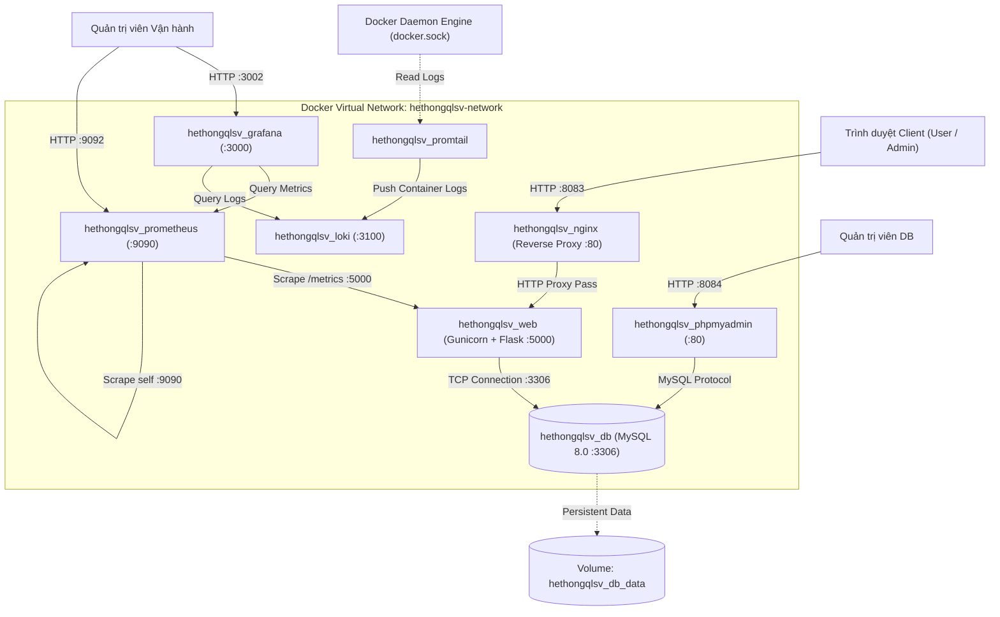

# KIẾN TRÚC TRIỂN KHAI HỆ THỐNG QUẢN LÝ SINH VIÊN
**Môn học:** Triển khai và quản trị hệ thống phần mềm  
**Hệ thống:** Quản lý Sinh viên, Đồ án và Thực tập tốt nghiệp  
**Môi trường:** Docker & Docker Compose trên nền tảng Windows / Linux  

---

## 1. Sơ đồ Kiến trúc Tổng thể (System Architecture)

Hệ thống được thiết kế và triển khai theo kiến trúc Micro-services hóa phân tầng (Multi-tier Containerized Architecture). Toàn bộ các dịch vụ được cô lập trong mạng ảo Docker `hethongqlsv-network` và được gán định danh thống nhất tiền tố `hethongqlsv_` để tránh xung đột tuyệt đối với các dự án khác trên cùng máy chủ.

---

## 2. Bảng Danh mục Dịch vụ (Service Inventory)

Hệ thống bao gồm **8 container dịch vụ** hoạt động đồng bộ:

| STT | Tên Container | Dịch vụ | Image Base | Cổng Host | Cổng Nội bộ | Cơ chế Bền vững (Storage) | Healthcheck |
| :--- | :--- | :--- | :--- | :--- | :--- | :--- | :--- |
| 1 | `hethongqlsv_nginx` | Reverse Proxy & Web Gateway | `nginx:alpine` | **8083** | 80 | Mount `./nginx/nginx.conf:ro` | Có (phụ thuộc web) |
| 2 | `hethongqlsv_web` | Backend App (Flask + Gunicorn) | Custom (`python:3.11-slim`) | Không expose | 5000 | Ephemeral (Code đóng gói image) | Kiểm tra qua depends_on DB |
| 3 | `hethongqlsv_db` | Cơ sở dữ liệu quan hệ MySQL | `mysql:8.0` | **3309** | 3306 | Named Volume `hethongqlsv_db_data` | `mysqladmin ping` (mỗi 5s) |
| 4 | `hethongqlsv_phpmyadmin` | Giao diện đồ họa quản trị DB | `phpmyadmin/phpmyadmin` | **8084** | 80 | Ephemeral | Phụ thuộc DB |
| 5 | `hethongqlsv_prometheus` | Giám sát & Thu thập Metrics | `prom/prometheus` | **9092** | 9090 | Mount `./prometheus/prometheus.yml:ro` | Scrape nội bộ |
| 6 | `hethongqlsv_grafana` | Bảng điều khiển trực quan hóa | `grafana/grafana` | **3002** | 3000 | Mount `./grafana/provisioning/` & `./grafana/dashboards/` | Built-in HTTP health |
| 7 | `hethongqlsv_loki` | Trung tâm tập trung Log | `grafana/loki:2.9.0` | **3102** | 3100 | Built-in storage container | Liveness probe HTTP |
| 8 | `hethongqlsv_promtail` | Thu thập Log Container | `grafana/promtail:2.9.0` | Không expose | N/A | Mount `/var/run/docker.sock` & `./promtail/promtail-config.yml` | Đẩy log sang Loki |

---

## 3. Vai trò và Nhiệm vụ Chi tiết của Từng Dịch vụ

### 3.1. Dịch vụ Nginx Reverse Proxy (`hethongqlsv_nginx`)
- **Vai trò:** Cổng giao tiếp duy nhất giữa người dùng bên ngoài và ứng dụng Flask nội bộ.
- **Tại sao cần trong môn học:** Ứng dụng Flask/Gunicorn không nên expose trực tiếp ra ngoài Internet để bảo vệ chống tấn công DoS, phân phối tĩnh nhanh hơn và quản lý tập trung chứng chỉ SSL/TLS hoặc tiêu đề HTTP an toàn.
- **Cấu hình nổi bật:**
  - Forward header: `Host`, `X-Real-IP`, `X-Forwarded-For`, `X-Forwarded-Proto`.
  - Giới hạn kích thước upload: `client_max_body_size 16M`.
  - Phục vụ tĩnh và chuyển hướng an toàn mọi request tới upstream `web:5000`.

### 3.2. Dịch vụ Ứng dụng Web (`hethongqlsv_web`)
- **Vai trò:** Xử lý toàn bộ logic nghiệp vụ của Hệ thống Quản lý Sinh viên (quản lý người dùng, sinh viên, giảng viên, phân công đồ án, chấm điểm, quản lý thực tập).
- **Runtime:** Chạy bằng WSGI Server chuẩn doanh nghiệp **Gunicorn** (`gunicorn --bind 0.0.0.0:5000 --workers 2 app:app`).
- **Bảo mật:** Chạy dưới tài khoản người dùng không đặc quyền (`USER appuser`, UID: 1000) trong Dockerfile, loại bỏ hoàn toàn nguy cơ chiếm quyền root máy chủ nếu ứng dụng bị xâm nhập.
- **Giám sát:** Tích hợp `prometheus_flask_exporter` tự động xuất metrics tại endpoint `/metrics`.

### 3.3. Dịch vụ Cơ sở dữ liệu (`hethongqlsv_db`)
- **Vai trò:** Lưu trữ toàn bộ dữ liệu quan hệ của hệ thống.
- **Đặc tính kỹ thuật:**
  - Phiên bản: MySQL 8.0.
  - Bảng mã: `utf8mb4` hỗ trợ đầy đủ tiếng Việt có dấu và ký tự đặc biệt.
  - Cơ chế bền vững: Gắn vào Docker Volume định danh `hethongqlsv_db_data`. Dữ liệu vẫn được bảo toàn nguyên vẹn khi container bị dừng, xóa hoặc khởi động lại.
  - Healthcheck tự động: Lệnh `mysqladmin ping -h localhost -u root -p$MYSQL_ROOT_PASSWORD` thực thi định kỳ 5 giây/lần. Container `hethongqlsv_web` chỉ được phép khởi động khi MySQL đã hoàn toàn sẵn sàng (`condition: service_healthy`).

### 3.4. Dịch vụ Quản trị DB (`hethongqlsv_phpmyadmin`)
- **Vai trò:** Cung cấp công cụ giao diện trực quan hỗ trợ giảng viên và sinh viên kiểm tra cấu trúc bảng, duyệt dữ liệu và tối ưu hóa truy vấn nhanh chóng mà không cần mở console CLI.
- **Kết nối:** Kết nối nội bộ tới hostname `db:3306` thông qua mạng Docker.

### 3.5. Dịch vụ Giám sát Prometheus (`hethongqlsv_prometheus`)
- **Vai trò:** Time-series database thu thập số liệu vận hành định kỳ (scrape pull model).
- **Targets:**
  - Endpoint `http://web:5000/metrics`: Thu thập số request HTTP, latency, mã trạng thái HTTP 2xx/4xx/5xx của Flask.
  - Endpoint `http://localhost:9090/metrics`: Tự giám sát tài nguyên của chính Prometheus.

### 3.6. Dịch vụ Bảng điều khiển Grafana (`hethongqlsv_grafana`)
- **Vai trò:** Trực quan hóa dữ liệu giám sát và nhật ký hệ thống trên một màn hình tập trung (Single Pane of Glass).
- **Cơ chế Tự động hóa (GitOps / Provisioning):**
  - Tự động nạp cấu hình Datasources từ `./grafana/provisioning/datasources/datasources.yml`.
  - Tự động nạp Dashboard tổng thể từ `./grafana/dashboards/hethongqlsv_overview.json`.
  - Không đòi hỏi người quản trị phải bấm tạo thủ công bằng tay sau mỗi lần deploy lại hệ thống.

### 3.7. Dịch vụ Lưu trữ Log Loki (`hethongqlsv_loki`) & Promtail (`hethongqlsv_promtail`)
- **Vai trò:** Hệ thống ghi log tập trung (Centralized Logging).
- **Nguyên lý hoạt động:**
  - `Promtail` gắn volume `/var/run/docker.sock`, lắng nghe stream log của các container có tiền tố `hethongqlsv_`.
  - Promtail đẩy log dạng nén về `Loki` qua cổng `3100`.
  - Quản trị viên sử dụng Grafana để tra cứu và truy vết log theo từ khóa hoặc thời gian thực mà không cần `docker logs` từng container.

---

## 4. Ma trận Giao tiếp Liên Dịch vụ (Inter-Service Communication)

| Nguồn (Source) | Đích (Destination) | Giao thức | Cổng nội bộ | Mục đích |
| :--- | :--- | :--- | :--- | :--- |
| `hethongqlsv_nginx` | `hethongqlsv_web` | HTTP | 5000 | Chuyển tiếp request người dùng |
| `hethongqlsv_web` | `hethongqlsv_db` | TCP/MySQL | 3306 | Truy vấn ORM SQLAlchemy |
| `hethongqlsv_phpmyadmin` | `hethongqlsv_db` | TCP/MySQL | 3306 | Quản trị dữ liệu trực quan |
| `hethongqlsv_prometheus` | `hethongqlsv_web` | HTTP | 5000 | Scrape metrics ứng dụng `/metrics` |
| `hethongqlsv_promtail` | `hethongqlsv_loki` | HTTP | 3100 | Vận chuyển log container về kho lưu trữ |
| `hethongqlsv_grafana` | `hethongqlsv_prometheus` | HTTP | 9090 | Truy vấn số liệu biểu đồ |
| `hethongqlsv_grafana` | `hethongqlsv_loki` | HTTP | 3100 | Truy vấn nhật ký hệ thống |

---

## 5. Cơ chế Bền vững Dữ liệu và Phục hồi (Data Persistence & Resilience)

1. **Dữ liệu Cơ sở dữ liệu:**
   - Được gắn cố định vào Named Volume: `hethongqlsv_db_data`.
   - Đường dẫn trong container: `/var/lib/mysql`.
   - **Xác minh thực tế:** Thử nghiệm dừng và khởi động lại container `hethongqlsv_db` hoặc build lại container `hethongqlsv_web` không làm mất bất kỳ bản ghi nào trong 12 bảng cơ sở dữ liệu.
2. **Chính sách Tự khởi động (Restart Policy):**
   - Tất cả các dịch vụ đều được gán `restart: unless-stopped`.
   - Khi hệ điều hành host hoặc Docker daemon khởi động lại, toàn bộ cụm dịch vụ tự động hoạt động trở lại theo đúng thứ tự phụ thuộc.
3. **Cơ chế Khởi động an toàn (Healthcheck Dependency):**
   - Sử dụng Docker Compose `condition: service_healthy` giữa `web` và `db`. Ứng dụng Flask tuyệt đối không khởi động cho đến khi MySQL xác nhận sẵn sàng tiếp nhận kết nối.

---

## 6. Tính Cô lập và An toàn Môi trường

1. **Cô lập Mạng:**
   - Toàn bộ dịch vụ nằm trong bridge network `hethongqlsv-network`.
   - Giao tiếp giữa các service diễn ra thông qua Docker DNS nội bộ (ví dụ: `http://db:3306`, `http://web:5000`, `http://prometheus:9090`).
2. **Tránh xung đột cổng host:**
   - Ứng dụng web dùng cổng `8083` (tránh cổng 80, 8080 mặc định).
   - MySQL dùng cổng `3309` (tránh cổng 3306 cục bộ trên máy host).
   - phpMyAdmin dùng cổng `8084`.
   - Prometheus dùng cổng `9092` (tránh 9090).
   - Grafana dùng cổng `3002` (tránh 3000).
   - Loki dùng cổng `3102` (tránh 3100).
