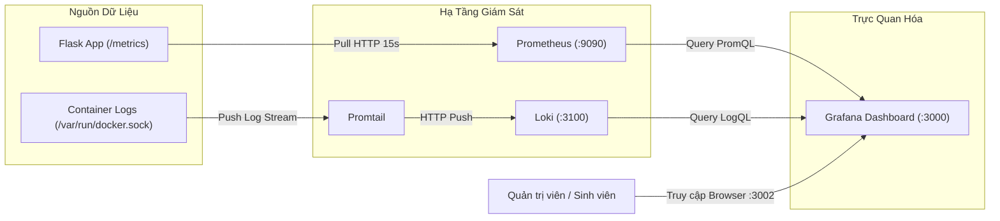

# HƯỚNG DẪN GIÁM SÁT HỆ THỐNG VÀ GHI LOG TẬP TRUNG
**Môn học:** Triển khai và quản trị hệ thống phần mềm  
**Hệ sinh thái Observability:** Prometheus + Grafana + Loki + Promtail  
**Mục tiêu:** Cung cấp khả năng quan sát toàn diện (Observability) gồm cả Metrics và Logs theo chuẩn Cloud-Native.

---

## 1. Tổng quan Kiến trúc Giám sát và Ghi log

Mô hình giám sát của hệ thống tuân thủ tiêu chuẩn công nghiệp hiện đại, bao gồm hai trụ cột chính:
1. **Time-Series Metrics (Số liệu hiệu năng):** Do **Prometheus** thu thập theo cơ chế Pull, lưu trữ và trực quan hóa trên **Grafana**.
2. **Centralized Logging (Nhật ký tập trung):** Do **Promtail** thu thập theo thời gian thực từ Docker Engine, đẩy về **Loki** và truy vấn thông qua giao diện Grafana Explore.



---

## 2. Giám sát Hiệu năng với Prometheus

### 2.1. Cấu hình Scrape (`prometheus/prometheus.yml`)
Prometheus được cấu hình chu kỳ cào dữ liệu (`scrape_interval`) là **15 giây** với 2 mục tiêu (targets):

```yaml
global:
  scrape_interval: 15s
  evaluation_interval: 15s

scrape_configs:
  - job_name: 'prometheus'
    static_configs:
      - targets: ['localhost:9090']

  - job_name: 'flask_app'
    metrics_path: '/metrics'
    static_configs:
      - targets: ['web:5000']
```

### 2.2. Kiểm tra Trạng thái Targets thực tế
Truy cập giao diện web của Prometheus: [http://localhost:9092/targets](http://localhost:9092/targets)
- `flask_app (http://web:5000/metrics)`: Trạng thái **UP** (Màu xanh).
- `prometheus (http://localhost:9090/metrics)`: Trạng thái **UP** (Màu xanh).

### 2.3. Các Chỉ số Vận hành Quan trọng (Key Metrics)
Trong môn học, người quản trị cần nắm rõ các metrics do `prometheus_flask_exporter` cung cấp:
- `flask_http_request_total`: Tổng số lượt yêu cầu HTTP gửi đến ứng dụng, phân loại theo `method`, `status` và `endpoint`.
- `flask_http_request_duration_seconds`: Thời gian phản hồi của ứng dụng (Latency).
- `up{job="flask_app"}`: Trạng thái sống còn của container backend (1 là Sống, 0 là Chết).

> [!NOTE]
> **Điểm mấu chốt trong môn học:** Phân biệt giữa Target `UP` và Nghiệp vụ xử lý đúng:
> - Chỉ số `up == 1` chỉ chứng minh rằng container Flask và máy chủ Gunicorn đang phản hồi cổng 5000.
> - Để biết nghiệp vụ có chạy đúng hay không, người quản trị phải theo dõi thêm tỷ lệ mã lỗi HTTP `status=~"5.."` so với tổng số request. Nếu tỷ lệ lỗi 5xx tăng vọt trong khi `up == 1`, hệ thống đang gặp lỗi ứng dụng hoặc mất kết nối DB.

---

## 3. Ghi Log Tập trung với Loki và Promtail

### 3.1. Nhiệm vụ của Promtail
- Promtail là một agent siêu nhẹ chạy dưới dạng container `hethongqlsv_promtail`.
- Gắn socket `/var/run/docker.sock` để lắng nghe luồng log tiêu chuẩn (stdout/stderr) của tất cả container có tên bắt đầu bằng `hethongqlsv_`.
- Promtail tự động gắn các nhãn (Labels) hữu ích như `container`, `job`, `stream` và đẩy sang Loki tại endpoint `http://loki:3100/loki/api/v1/push`.

### 3.2. Cú pháp Truy vấn LogQL trong Grafana Explore
Mở Grafana tại [http://localhost:3002](http://localhost:3002), chọn menu **Explore** và chọn datasource **Loki**:

1. **Xem toàn bộ log của ứng dụng Web Flask:**
   ```logql
   {container="hethongqlsv_web"}
   ```
2. **Tìm kiếm các log chứa từ khóa lỗi:**
   ```logql
   {container="hethongqlsv_web"} |= "ERROR"
   ```
3. **Xem log truy cập của Reverse Proxy Nginx:**
   ```logql
   {container="hethongqlsv_nginx"}
   ```
4. **Theo dõi log kết nối cơ sở dữ liệu MySQL:**
   ```logql
   {container="hethongqlsv_db"}
   ```

---

## 4. Bảng Điều Khiển Grafana (Dashboard)

Hệ thống đã được cấu hình **Provisioning tự động** (Infrastructure-as-Code cho Monitoring):
- Datasources được khai báo tại: `./grafana/provisioning/datasources/datasources.yml`.
- Dashboard được nạp tự động từ: `./grafana/dashboards/hethongqlsv_overview.json`.

Khi người dùng mở Grafana tại [http://localhost:3002](http://localhost:3002) (Tài khoản: `admin` / `admin`), Dashboard chính thức **"Hệ thống Quản lý Sinh viên - Giám sát Tổng thể"** (UID: `as2r56`) đã có sẵn và hiển thị trực tiếp dữ liệu thực:

### Chi tiết 6 Panel Giám sát trên Dashboard:

| STT | Tên Panel | Kiểu Trực quan | Nguồn Dữ liệu | Câu truy vấn (Query) | Ý nghĩa Quản trị |
| :--- | :--- | :--- | :--- | :--- | :--- |
| 1 | **Flask App Health** | Stat Box | Prometheus | `up{job="flask_app"}` | Báo động tức thì nếu Web Container bị sập (ONLINE/OFFLINE). |
| 2 | **Prometheus Scrape Status** | Stat Box | Prometheus | `up{job="prometheus"}` | Kiểm tra tính sẵn sàng của hạ tầng thu thập số liệu. |
| 3 | **Total HTTP Requests** | Stat Box | Prometheus | `sum(flask_http_request_total)` | Tổng lưu lượng truy cập hệ thống đã phục vụ từ lúc bật. |
| 4 | **HTTP Status Code Distribution** | Pie Chart / Stat | Prometheus | `sum by (status) (flask_http_request_total)` | Tỷ lệ phản hồi thành công (200, 302) vs Lỗi người dùng (404) vs Lỗi máy chủ (500). |
| 5 | **HTTP Request Rate by Endpoint** | Time-series Graph | Prometheus | `sum by (path) (rate(flask_http_request_total[1m]))` | Biểu đồ lưu lượng request/giây theo từng chức năng (login, student, do_an). |
| 6 | **Live Container Application Logs** | Logs Stream Panel | Loki | `{container=~"hethongqlsv_.*"}` | Dòng log thời gian thực chạy trực tiếp từ tất cả container của hệ thống. |

---

## 5. Kịch bản Thiết lập Cảnh báo Tự động (Alerting Rules)

Trong môi trường triển khai thực tế, quản trị viên thiết lập các cảnh báo tự động gửi về Email hoặc Telegram:

1. **Cảnh báo Service Down (Nghiêm trọng - Severity Critical):**
   ```yaml
   alert: FlaskAppDown
   expr: up{job="flask_app"} == 0
   for: 1m
   labels:
     severity: critical
   annotations:
     summary: "Ứng dụng Flask Quản lý Sinh viên đang dừng hoạt động!"
     description: "Target web:5000 không phản hồi quá 1 phút."
   ```

2. **Cảnh báo Tỷ lệ Lỗi 5xx Tăng cao (Cảnh báo - Severity Warning):**
   ```yaml
   alert: HighHttpErrorRate
   expr: sum(rate(flask_http_request_total{status=~"5.."}[5m])) / sum(rate(flask_http_request_total[5m])) * 100 > 5
   for: 2m
   labels:
     severity: warning
   annotations:
     summary: "Tỷ lệ lỗi HTTP 5xx vượt quá 5% trong 5 phút qua."
   ```
