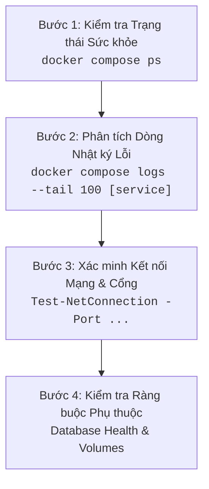

# CẨM NANG VẬN HÀNH VÀ XỬ LÝ SỰ CỐ (OPERATIONS & TROUBLESHOOTING)
**Môn học:** Triển khai và quản trị hệ thống phần mềm  
**Hệ thống:** Quản lý Sinh viên, Đồ án và Thực tập  
**Mục tiêu:** Hướng dẫn kỹ sư vận hành phương pháp chẩn đoán nguyên nhân gốc (Root Cause Analysis - RCA) và quy trình khắc phục nhanh chóng, an toàn.

---

## 1. Quy trình Chẩn đoán Sự cố Chuẩn 4 Bước (4-Step Standard Diagnostic)

Khi hệ thống gặp sự cố bất thường, người quản trị không được vội vàng khởi động lại bừa bãi mà phải thực hiện tuần tự theo quy trình:



---

## 2. Xử lý 8 Sự cố Kinh điển trong Vận hành Hệ thống

### Sự cố 1: Container Web bị văng (Crash Loop) do Database khởi động chậm
- **Hiện tượng:** Container `hethongqlsv_web` liên tục `Restarting` hoặc báo lỗi `Can't connect to MySQL server on 'db' (111)`.
- **Nguyên nhân gốc:** MySQL 8.0 mất khoảng 15–30 giây để khởi tạo bộ nhớ đệm và dữ liệu bảng. Nếu ứng dụng web cố gắng kết nối trước khi MySQL mở cổng tiếp nhận, tiến trình Python sẽ bị Exception và thoát.
- **Giải pháp triệt để đã triển khai:**
  1. Thêm khối `healthcheck` cho container `hethongqlsv_db` trong `docker-compose.yml`:
     ```yaml
     healthcheck:
       test: ["CMD-SHELL", "mysqladmin ping -h localhost -u root -p$${MYSQL_ROOT_PASSWORD}"]
       interval: 5s
       timeout: 5s
       retries: 10
     ```
  2. Khai báo ràng buộc phụ thuộc có điều kiện tại service `web`:
     ```yaml
     depends_on:
       db:
         condition: service_healthy
     ```
  Container `web` sẽ kiên nhẫn đợi MySQL xác nhận khỏe mạnh rồi mới khởi chạy.

---

### Sự cố 2: Xung đột Cổng kết nối (Port Conflict) trên Máy chủ Windows
- **Hiện tượng:** Khi chạy `docker compose up -d`, Docker báo lỗi:  
  `Error response from daemon: Ports are not available: listen tcp 0.0.0.0:8083: bind: address already in use`
- **Nguyên nhân gốc:** Cổng dự kiến sử dụng đang bị một tiến trình khác trên máy tính chiếm dụng (ví dụ: IIS, Skype, dịch vụ MySQL chạy nền của XAMPP/WAMP).
- **Quy trình xử lý an toàn:**
  1. Kiểm tra tiến trình đang chiếm cổng bằng PowerShell (ví dụ cổng 8083):
     ```powershell
     Get-NetTCPConnection -LocalPort 8083 -ErrorAction SilentlyContinue | Select-Object LocalAddress, LocalPort, OwningProcess
     ```
  2. Xác định tên tiến trình thông qua PID:
     ```powershell
     Get-Process -Id <PID>
     ```
  3. Nếu không thể tắt phần mềm kia, đổi cổng trong tệp `.env` sang một cổng tự do khác (ví dụ: `WEB_PORT=8089` hoặc `DB_PORT=3310`).
  4. Khởi động lại: `docker compose up -d`.

---

### Sự cố 3: Nginx phản hồi lỗi `502 Bad Gateway`
- **Hiện tượng:** Truy cập [http://localhost:8083](http://localhost:8083) nhận được trang thông báo trắng có chữ `502 Bad Gateway`.
- **Nguyên nhân gốc:** Nginx đang chạy tốt nhưng không thể kết nối tới upstream backend `web:5000` (container `web` bị chết hoặc Gunicorn chưa khởi động xong).
- **Quy trình xử lý:**
  1. Kiểm tra trạng thái của container web:
     ```powershell
     docker compose ps web
     ```
  2. Xem nguyên nhân gây lỗi trong log của web:
     ```powershell
     docker compose logs --tail 50 web
     ```
  3. Nếu do lỗi cú pháp code Python hoặc thiếu thư viện, sửa code trên host rồi chạy:
     ```powershell
     docker compose restart web
     ```

---

### Sự cố 4: Lỗi mất kết nối CSDL `OperationalError: (2006, 'MySQL server has gone away')`
- **Hiện tượng:** Ứng dụng để một thời gian dài không dùng, khi người dùng bấm vào một tính năng thì xuất hiện lỗi máy chủ 500.
- **Nguyên nhân gốc:** MySQL tự động ngắt kết nối không hoạt động (idle connection timeout) sau khoảng thời gian `wait_timeout`. SQLAlchemy connection pool giữ lại socket cũ đã bị đóng.
- **Giải pháp triển khai trong mã nguồn Flask:** Cấu hình SQLAlchemy Pool Recycle tự động làm mới kết nối:
  ```python
  app.config['SQLALCHEMY_ENGINE_OPTIONS'] = {
      'pool_recycle': 280,
      'pool_pre_ping': True
  }
  ```
  `pool_pre_ping=True` giúp ứng dụng tự động kiểm tra xem kết nối DB còn sống hay không trước khi gửi truy vấn nghiệp vụ.

---

### Sự cố 5: Tài khoản Quản trị bị Khóa hoặc Quên Mật khẩu
- **Hiện tượng:** Đăng nhập hiển thị thông báo "Tài khoản của bạn đã bị khóa hoặc không có quyền truy cập!".
- **Nguyên nhân gốc:** Quản trị viên vô tình chuyển trạng thái tài khoản sang `Khoa` hoặc nhập sai mật khẩu.
- **Quy trình mở khóa an toàn trực tiếp từ dòng lệnh:**
  1. Chạy câu lệnh SQL cập nhật trạng thái tài khoản thành `HoatDong`:
     ```powershell
     docker exec -i hethongqlsv_db mysql -u root -p${env:DB_PASSWORD} student_db -e "UPDATE user SET status = 'HoatDong' WHERE username = 'admin';"
     ```
  2. Kiểm tra lại kết quả:
     ```powershell
     docker exec -i hethongqlsv_db mysql -u root -p${env:DB_PASSWORD} student_db -e "SELECT id, username, role, status FROM user WHERE username = 'admin';"
     ```

---

### Sự cố 6: Grafana Không Hiển thị Biểu đồ hoặc Báo lỗi Datasource
- **Hiện tượng:** Bảng điều khiển Grafana hiển thị thông báo "No data" hoặc "Data source connection error".
- **Nguyên nhân gốc:** Grafana không thể kết nối tới Prometheus cổng 9090 hoặc Loki cổng 3100 trong mạng nội bộ.
- **Quy trình xử lý:**
  1. Kiểm tra Prometheus và Loki có đang `Up` không:
     ```powershell
     docker compose ps prometheus loki
     ```
  2. Kiểm tra đường truyền mạng nội bộ giữa các container:
     ```powershell
     docker exec -it hethongqlsv_grafana nc -zv prometheus 9090
     docker exec -it hethongqlsv_grafana nc -zv loki 3100
     ```
  3. Nạp lại cấu hình provisioning:
     ```powershell
     docker compose restart grafana
     ```

---

### Sự cố 7: Promtail Không Đẩy được Log về Loki trên Windows
- **Hiện tượng:** Truy cập Grafana Explore -> Loki không thấy xuất hiện bất kỳ dòng nhật ký nào.
- **Nguyên nhân gốc:** Trên Windows, việc mount socket `/var/run/docker.sock` vào container Linux của Promtail có thể gặp lỗi phân quyền hoặc Docker Desktop chưa kích hoạt tùy chọn "Expose daemon on tcp://localhost:2375 without TLS".
- **Giải pháp:**
  1. Kiểm tra log của Promtail:
     ```powershell
     docker compose logs --tail 30 promtail
     ```
  2. Trong trường hợp socket bị chặn trên Windows, cấu hình ứng dụng web xuất log trực tiếp ra tệp và mount thư mục log vào container Promtail.

---

### Sự cố 8: Tràn Ổ đĩa do Dung lượng Nhật ký Container Quá lớn
- **Hiện tượng:** Sau vài tuần vận hành, ổ đĩa C: bị đầy bất thường.
- **Nguyên nhân gốc:** Mặc định Docker ghi log dạng json không giới hạn kích thước, tệp log container có thể phình to hàng chục GB.
- **Giải pháp đã áp dụng trong `docker-compose.yml`:** Cấu hình chính sách xoay vòng log (Log Rotation) cho dịch vụ:
  ```yaml
  logging:
    driver: "json-file"
    options:
      max-size: "10m"
      max-file: "3"
  ```
  Mỗi tệp log tối đa 10MB và chỉ lưu giữ tối đa 3 tệp cũ nhất. Tự động dọn dẹp khi vượt quá giới hạn.

---

## 3. Bảng Tra cứu Nhanh Mã Trạng thái HTTP và Hành động Xử lý

| Mã HTTP | Tên Trạng thái | Nguyên nhân Thường gặp | Hành động Khắc phục |
| :---: | :--- | :--- | :--- |
| **200** | OK | Request thành công bình thường | Không cần xử lý. |
| **302** | Found (Redirect) | Chuyển hướng sau khi đăng nhập/đăng xuất/CRUD | Hành vi nghiệp vụ bình thường. |
| **400** | Bad Request | Dữ liệu form gửi lên sai định dạng | Kiểm tra trường input hoặc payload JSON. |
| **401** | Unauthorized | Chưa đăng nhập hệ thống | Đăng nhập tài khoản trước khi truy cập. |
| **403** | Forbidden | Đã đăng nhập nhưng không đủ quyền hạn vai trò | Kiểm tra phân quyền tài khoản (Admin vs Sinh viên). |
| **404** | Not Found | Đường dẫn URL không tồn tại | Kiểm tra lại route trong file `app/app.py`. |
| **500** | Internal Server Error | Ngoại lệ unhandled Exception trong code Python | Kiểm tra log `docker compose logs web`. |
| **502** | Bad Gateway | Nginx không kết nối được upstream web | Kiểm tra container `hethongqlsv_web` có đang chạy không. |
| **504** | Gateway Timeout | Truy vấn SQL quá nặng làm treo request | Tối ưu hóa chỉ mục (Indexes) hoặc câu lệnh SQL. |
