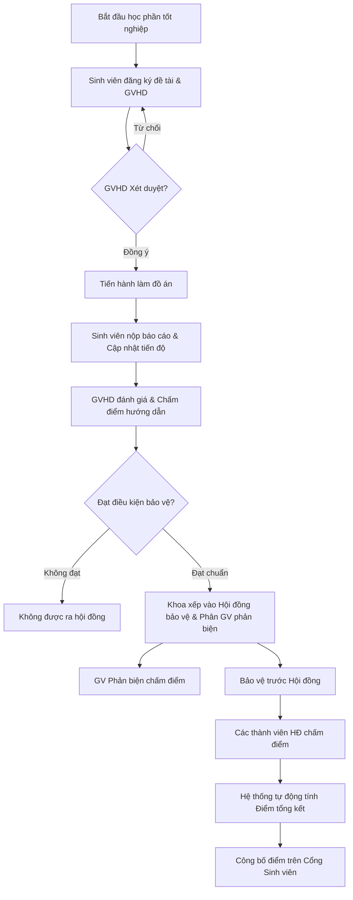
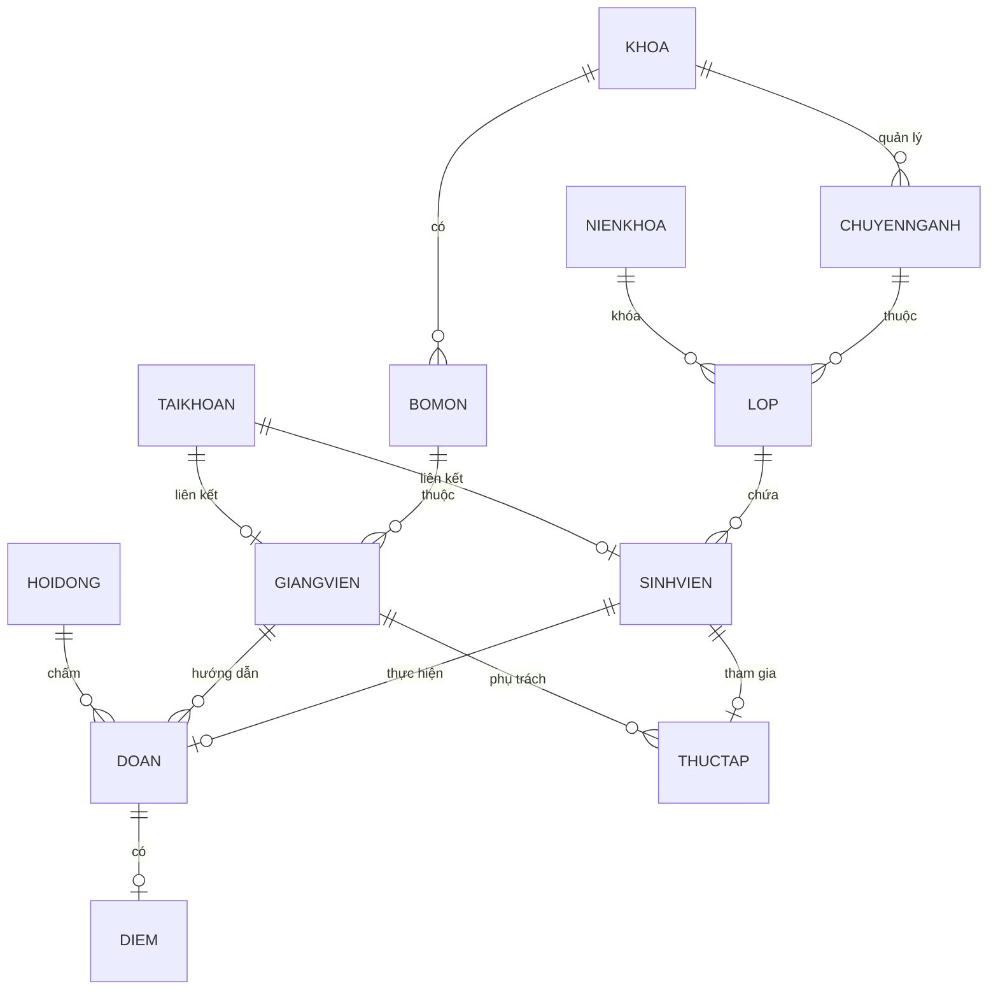
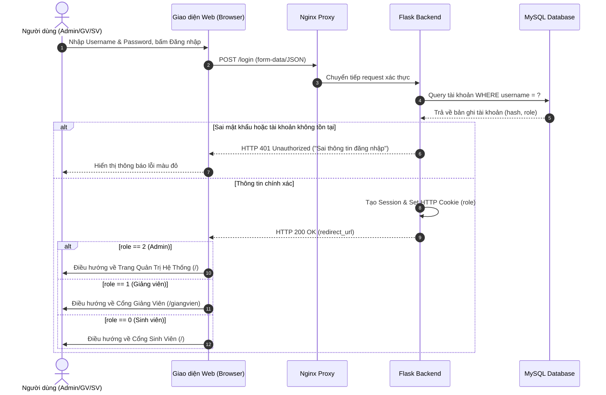
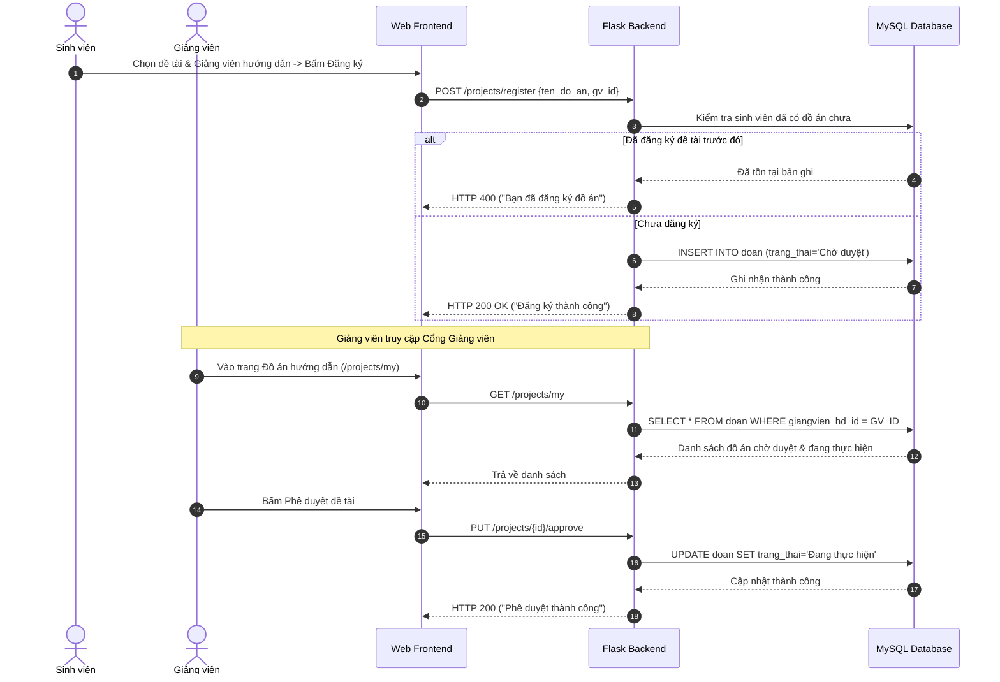

# TÀI LIỆU ĐẶC TẢ YÊU CẦU PHẦN MỀM (SRS)
## HỆ THỐNG QUẢN LÝ ĐỒ ÁN VÀ THỰC TẬP TỐT NGHIỆP SINH VIÊN

**Đơn vị đào tạo:** TRƯỜNG ĐẠI HỌC THỦY LỢI – KHOA CÔNG NGHỆ THÔNG TIN  
**Phiên bản:** 2.0 (Production Release)  
**Tiêu chuẩn áp dụng:** IEEE Std 830-1998 (Recommended Practice for Software Requirements Specifications)  
**Ngày cập nhật:** 23/10/2026  

---

## MỤC LỤC
1. [GIỚI THIỆU TỔNG QUAN](#1-giới-thiệu-tổng-quan)
   - 1.1. Mục đích tài liệu
   - 1.2. Bối cảnh và phạm vi dự án
   - 1.3. Định nghĩa, thuật ngữ và từ viết tắt
2. [MÔ TẢ TỔNG THỂ HỆ THỐNG](#2-mô-tả-tổng-thể-hệ-thống)
   - 2.1. Kiến trúc hệ thống tổng quan
   - 2.2. Các tác nhân trong hệ thống (Actors)
   - 2.3. Ma trận phân quyền tác nhân (RBAC Matrix)
   - 2.4. Môi trường triển khai và vận hành
3. [ĐẶC TẢ YÊU CẦU CHỨC NĂNG (FUNCTIONAL REQUIREMENTS)](#3-đặc-tả-yêu-cầu-chức-năng)
   - 3.1. Phân hệ Xác thực & Quản lý Tài khoản (Authentication & RBAC)
   - 3.2. Phân hệ Quản trị viên (Admin Portal)
   - 3.3. Phân hệ Giảng viên (Lecturer Portal)
   - 3.4. Phân hệ Sinh viên (Student Portal)
   - 3.5. Quy trình nghiệp vụ cốt lõi (Core Business Workflows)
   - 3.6. Công thức tính toán và ràng buộc dữ liệu
4. [ĐẶC TẢ MÔ HÌNH DỮ LIỆU (DATABASE SPECIFICATION)](#4-đặc-tả-mô-hình-dữ-liệu)
   - 4.1. Sơ đồ quan hệ thực thể (ERD)
   - 4.2. Chi tiết các bảng dữ liệu (Data Dictionary)
5. [ĐẶC TẢ YÊU CẦU PHI CHỨC NĂNG (NON-FUNCTIONAL REQUIREMENTS)](#5-đặc-tả-yêu-cầu-phi-chức-năng)
   - 5.1. Hiệu năng (Performance)
   - 5.2. Bảo mật (Security)
   - 5.3. Tính sẵn sàng và Sao lưu dữ liệu (Availability & Disaster Recovery)
   - 5.4. Khả năng tương thích và Giao diện (Usability & Compatibility)
   - 5.5. Hệ thống Giám sát & Nhật ký (Monitoring & Logging)
6. [SƠ ĐỒ TRÌNH TỰ & TƯƠNG TÁC (SEQUENCE DIAGRAMS)](#6-sơ-đồ-trình-tự--tương-tác)

---

## 1. GIỚI THIỆU TỔNG QUAN

### 1.1. Mục đích tài liệu
Tài liệu Đặc tả Yêu cầu Phần mềm (Software Requirements Specification - SRS) này mô tả toàn diện và chi tiết các yêu cầu nghiệp vụ, chức năng, phi chức năng, kiến trúc kỹ thuật và mô hình dữ liệu của **Hệ thống Quản lý Đồ án và Thực tập Tốt nghiệp Sinh viên**. 
Tài liệu đóng vai trò là chuẩn mực kỹ thuật cho việc kiểm thử, bàn giao, vận hành và phát triển mở rộng hệ thống.

### 1.2. Bối cảnh và phạm vi dự án
Mỗi năm, Khoa Công nghệ Thông tin – Trường Đại học Thủy Lợi có hàng trăm sinh viên thực hiện học phần thực tập doanh nghiệp và làm đồ án tốt nghiệp. Khi chưa áp dụng tin học hóa toàn diện, việc tiếp nhận đăng ký, xét duyệt đề tài, phân công giảng viên hướng dẫn, thành lập hội đồng chấm bảo vệ và quản lý điểm số gặp nhiều khó khăn, dễ nhầm lẫn và thiếu tính đồng bộ.

**Phạm vi hệ thống bao gồm:**
- Quản lý danh mục tổ chức học thuật: Khoa, Bộ môn, Chuyên ngành, Niên khóa, Lớp học.
- Quản lý hồ sơ nhân sự: Sinh viên, Giảng viên, Tài khoản người dùng.
- Quản lý quy trình thực tập doanh nghiệp của sinh viên.
- Quản lý vòng đời đồ án tốt nghiệp: Đăng ký đề tài, duyệt hướng dẫn, theo dõi tiến độ, thành lập hội đồng bảo vệ, nhập điểm và xếp loại học thuật.
- Cổng thông tin tương tác đa kênh phục vụ đồng thời 3 nhóm đối tượng: Quản trị viên (Phòng Đào tạo/Khoa), Giảng viên và Sinh viên.
- Hạ tầng dịch vụ container hóa với hệ thống giám sát và sao lưu dữ liệu tự động.

### 1.3. Định nghĩa, thuật ngữ và từ viết tắt
| Thuật ngữ / Viết tắt | Ý nghĩa |
| :--- | :--- |
| **SRS** | Software Requirements Specification (Đặc tả yêu cầu phần mềm) |
| **RBAC** | Role-Based Access Control (Kiểm soát truy cập dựa trên vai trò) |
| **Admin** | Quản trị viên hệ thống (Role 2) |
| **Lecturer / GV** | Giảng viên hướng dẫn / phản biện / hội đồng (Role 1) |
| **Student / SV** | Sinh viên thực hiện đồ án và thực tập (Role 0) |
| **HĐ** | Hội đồng bảo vệ đồ án tốt nghiệp |
| **ĐA** | Đồ án tốt nghiệp |
| **GPA** | Grade Point Average (Điểm trung bình tích lũy thang điểm 10 hoặc 4) |
| **ERD** | Entity-Relationship Diagram (Sơ đồ quan hệ thực thể) |

---

## 2. MÔ TẢ TỔNG THỂ HỆ THỐNG

### 2.1. Kiến trúc hệ thống tổng quan
Hệ thống được thiết kế theo mô hình kiến trúc **3-Tier Containerized Architecture**, gồm các tầng:

```
[ Client Trình Duyệt: Desktop / Tablet / Mobile ]
                     │ (HTTPS / HTTP)
                     ▼
          [ Nginx Reverse Proxy (Port 8083) ]
          │ (Forward Static / API proxy)
          ▼
   [ Application Server: Python 3.10 Flask + Gunicorn WSGI ]
   │                 (RESTful APIs, Session Auth, Business Rules)
   ├──────────────────────────────┬──────────────────────────────┐
   ▼                              ▼                              ▼
[ MySQL 8.0 Database ]    [ Prometheus Engine ]          [ Promtail Collector ]
(Data Storage & Relational) (System & App Metrics)       (Gunicorn & App Logs)
                                  │                              │
                                  ▼                              ▼
                         [ Grafana Dashboard ]            [ Loki Log Storage ]
```

- **Tầng Trình bày (Presentation Tier):** Giao diện HTML5 chuẩn Semantic, phong cách thiết kế hiện đại (Glassmorphism, Vibrant Gradient Cards, Responsive Grid), điều khiển tương tác bằng JavaScript độc lập (Vanilla ES6+).
- **Tầng Xử lý Nghiệp vụ (Application Tier):** Python 3.10 Flask framework phục vụ RESTful JSON API và Jinja2 Template rendering, chạy dưới sự quản lý của Gunicorn WSGI đa luồng (Multi-workers).
- **Tầng Dữ liệu (Data Tier):** CSDL quan hệ MySQL 8.0 InnoDB, đảm bảo tính toàn vẹn khóa ngoại (Foreign Keys), ràng buộc kiểm tra (Check Constraints) và giao dịch ACID.
- **Tầng Giám sát & Vận hành (Observability Tier):** Nginx Gateway, Prometheus theo dõi chỉ số tài nguyên, Grafana hiển thị trực quan và Loki/Promtail thu thập log tập trung.

### 2.2. Các tác nhân trong hệ thống (Actors)
1. **Quản trị viên (Admin - Role 2):** Cán bộ giáo vụ / quản trị viên khoa quản lý toàn bộ cấu hình, dữ liệu danh mục đào tạo, phân quyền tài khoản, thành lập hội đồng và giám sát trạng thái toàn hệ thống.
2. **Giảng viên (Lecturer - Role 1):** Cán bộ giảng dạy tham gia xét duyệt đề tài của sinh viên, theo dõi lịch bảo vệ, cập nhật tiến độ hướng dẫn, tham gia hội đồng và nhập điểm đánh giá.
3. **Sinh viên (Student - Role 0):** Người học tham gia đăng ký thực tập, đăng ký đề tài đồ án, theo dõi phê duyệt của giảng viên, tra cứu thông tin hội đồng và kết quả điểm số.

### 2.3. Ma trận phân quyền tác nhân (RBAC Matrix)

| Chức năng / Phân hệ | Khách (Chưa login) | Sinh viên (Role 0) | Giảng viên (Role 1) | Quản trị viên (Role 2) |
| :--- | :---: | :---: | :---: | :---: |
| **Đăng nhập hệ thống (`/login`)** | Có | Có | Có | Có |
| **Đổi mật khẩu cá nhân** | Không | Có | Có | Có |
| **Trang chủ Cổng Sinh viên (`/api/student/portal`)** | Không | **Toàn quyền** | Không | Không |
| **Xem đề tài & điểm của bản thân (`/projects/my`, `/grades/my`)**| Không | **Toàn quyền** | Không | Không |
| **Xem thực tập của bản thân (`/internships/my`)** | Không | **Toàn quyền** | Không | Không |
| **Trang chủ Cổng Giảng viên (`/api/lecturer/portal`)** | Không | Không | **Toàn quyền** | Không |
| **Xem đề tài hướng dẫn & hội đồng (`/councils/my`)** | Không | Không | **Toàn quyền** | Không |
| **Chấm điểm đồ án hướng dẫn & phản biện** | Không | Không | **Toàn quyền** | Có |
| **Truy cập 11 trang Quản lý Admin** | Không | Bị chặn (403) | Bị chặn (403) | **Toàn quyền** |
| **Quản lý danh mục (Khoa, Bộ môn, Lớp, Niên khóa)** | Không | Không | Không | **Toàn quyền (CRUD)** |
| **Quản lý Tài khoản & Phân quyền (`/taikhoan`)** | Không | Không | Không | **Toàn quyền (CRUD)** |
| **Sao lưu & Phục hồi CSDL (`/api/admin/backups`)** | Không | Không | Không | **Toàn quyền** |

---

## 3. ĐẶC TẢ YÊU CẦU CHỨC NĂNG

### 3.1. Phân hệ Xác thực & Quản lý Tài khoản (Authentication & RBAC)
- **UC-AUTH-01: Đăng nhập (Sign In)**
  - *Đầu vào:* `username` (Mã tài khoản) và `password` (Mật khẩu).
  - *Xử lý:* Hệ thống đối chiếu hash mật khẩu trong bảng `taikhoan`. Nếu hợp lệ, lưu trữ session cookie định danh vai trò (`role`) và chuyển hướng người dùng tương ứng:
    - `role = 2` -> Chuyển đến Trang Quản trị (`/`).
    - `role = 1` -> Chuyển đến Cổng Giảng viên (`/giangvien` hoặc portal view).
    - `role = 0` -> Chuyển đến Cổng Sinh viên (`/` với student view).
  - *Ngoại lệ:* Sai tài khoản/mật khẩu -> Trả về lỗi `"Tên tài khoản hoặc mật khẩu không chính xác"`.
- **UC-AUTH-02: Đăng xuất (Sign Out)**
  - Hủy session hiện tại và chuyển hướng về màn hình đăng nhập `/login`.
- **UC-AUTH-03: Đổi mật khẩu (Change Password)**
  - Người dùng nhập mật khẩu cũ, mật khẩu mới và xác nhận mật khẩu mới.
  - Mật khẩu mới có độ dài từ 6 đến 30 ký tự và không được trùng với mật khẩu cũ.
- **UC-AUTH-04: Đặt lại mật khẩu (Reset Password - Admin only)**
  - Admin có thể reset mật khẩu của bất kỳ user nào về mật khẩu mặc định (mặc định chính là username/mã đối tượng).

### 3.2. Phân hệ Quản trị viên (Admin Portal)
Quản trị viên có toàn quyền truy cập 11 phân hệ thông qua thanh điều hướng chuyên nghiệp:
1. **Quản lý Sinh viên (`/`):**
   - Xem danh sách đầy đủ sinh viên, hiển thị ảnh đại diện, MSV, Họ tên, Giới tính, Ngày sinh, Lớp, Ngành, Khoa, Điểm GPA, xếp loại học lực, cờ trạng thái làm đồ án và thực tập.
   - 6 thẻ KPI tổng quan hệ thống + 4 thẻ thống kê sinh viên (Tổng SV, GPA TB, Xuất sắc/Giỏi, Khá/TB).
   - Tìm kiếm tức thời theo MSV, Họ tên, Lớp học; Bộ lọc đa tiêu chí theo Ngành học, Khoa và Xếp loại.
   - Thêm mới, Sửa, Xóa hồ sơ sinh viên (Tự động khởi tạo tài khoản đăng nhập `role = 0`).
2. **Quản lý Giảng viên (`/giangvien`):**
   - Quản lý mã GV, họ tên, email, số điện thoại, bộ môn, khoa, học vị (GS, PGS, TS, ThS), hướng nghiên cứu và số lượng đề tài đang hướng dẫn (`supervised_count`).
   - Thêm, sửa, xóa giảng viên (Tự động khởi tạo tài khoản đăng nhập `role = 1`).
3. **Quản lý Đồ án tốt nghiệp (`/doan`):**
   - Quản lý tên đề tài đồ án, mã đồ án, sinh viên thực hiện, giảng viên hướng dẫn, giảng viên phản biện, ngày bắt đầu, ngày kết thúc, tiến độ thực hiện (0 - 100%), trạng thái xét duyệt và hội đồng bảo vệ liên kết.
4. **Quản lý Thực tập doanh nghiệp (`/thuctap`):**
   - Ghi nhận thông tin thực tập của sinh viên: Tên công ty/tập đoàn, vị trí thực tập (Frontend, Backend, DevOps, Data,...), thời gian bắt đầu, thời gian kết thúc, giảng viên phụ trách và điểm đánh giá từ doanh nghiệp.
5. **Quản lý Hội đồng bảo vệ (`/hoidong`):**
   - Thành lập hội đồng bảo vệ đồ án tốt nghiệp: Tên hội đồng, địa điểm phòng bảo vệ, thời gian làm việc, phân công chủ tịch hội đồng, thư ký, ủy viên phản biện.
   - Liên kết danh sách các đồ án được phân công bảo vệ tại hội đồng.
6. **Quản lý Điểm (`/diem`):**
   - Quản lý chi tiết điểm đồ án tốt nghiệp: Điểm giảng viên hướng dẫn (HD), Điểm phản biện (PB), Điểm thành viên hội đồng (HĐ1, HĐ2, HĐ3), Điểm trung bình hội đồng và Điểm tổng kết cuối cùng.
7. **Quản lý Tổ chức học thuật (`/khoa_bomon`, `/chuyennganh`, `/nienkhoa`, `/lop`):**
   - CRUD danh mục Khoa và các Bộ môn trực thuộc.
   - Quản lý các Chuyên ngành đào tạo.
   - Quản lý Niên khóa (Khóa 60, Khóa 61,...).
   - Quản lý danh sách Lớp học trực thuộc Chuyên ngành và Niên khóa.
8. **Quản lý Tài khoản & Sao lưu (`/taikhoan`, `/api/admin/backups`):**
   - Xem danh sách người dùng hệ thống, trạng thái kích hoạt, phân quyền role.
   - Thực hiện tạo bản sao lưu dữ liệu CSDL `.sql` tức thời, tải file backup về máy hoặc khôi phục trực tiếp từ danh sách backup.

### 3.3. Phân hệ Giảng viên (Lecturer Portal)
- **Cổng thông tin cá nhân:** Tra cứu hồ sơ giảng viên, số lượng sinh viên đang hướng dẫn.
- **Danh sách đề tài hướng dẫn (`/projects/my`):**
  - Hiển thị danh sách sinh viên đang thực hiện đồ án dưới sự hướng dẫn của giảng viên.
  - Cập nhật tiến độ đồ án (25%, 50%, 75%, 100%) và nhận xét góp ý.
  - Nhập điểm đánh giá của giảng viên hướng dẫn (thang điểm 0 - 10).
- **Hội đồng tham gia (`/councils/my`):**
  - Xem lịch bảo vệ, danh sách đề tài và sinh viên sẽ báo cáo trước hội đồng mà giảng viên làm thành viên.
  - Nhập điểm thành viên hội đồng cho từng sinh viên bảo vệ.

### 3.4. Phân hệ Sinh viên (Student Portal)
- **Cổng thông tin học tập cá nhân:**
  - Tra cứu hồ sơ sinh viên: Mã SV, Lớp, Ngành, Khoa, Điểm GPA tích lũy, Xếp loại tốt nghiệp.
- **Theo dõi Đồ án tốt nghiệp:**
  - Tra cứu thông tin đề tài đã đăng ký, Giảng viên hướng dẫn, Giảng viên phản biện.
  - Theo dõi tiến độ hoàn thành đồ án và nhận xét từ giảng viên.
  - Xem lịch phân công bảo vệ: Tên hội đồng, ngày giờ, địa điểm phòng họp.
- **Tra cứu Điểm tốt nghiệp:**
  - Xem bảng điểm minh bạch: Điểm hướng dẫn, Điểm phản biện, Điểm hội đồng và Điểm tổng kết đồ án.
- **Thông tin Thực tập doanh nghiệp:**
  - Tra cứu công ty thực tập tiếp nhận, vị trí công việc, thời gian thực tập và kết quả đánh giá.

### 3.5. Quy trình nghiệp vụ cốt lõi (Core Business Workflows)



### 3.6. Công thức tính toán và ràng buộc dữ liệu
1. **Điểm trung bình Hội đồng ($D_{HĐ}$):**
   $$D_{HĐ} = \frac{D_{Thành\_viên\_1} + D_{Thành\_viên\_2} + \dots + D_{Thành\_viên\_n}}{n}$$
2. **Điểm tổng kết Đồ án Tốt nghiệp ($D_{Tổng}$):**
   Áp dụng theo quy chế đào tạo hiện hành của Đại học Thủy Lợi:
   $$D_{Tổng} = (D_{Hướng\_dẫn} \times 0.3) + (D_{Phản\_biện} \times 0.2) + (D_{Hội\_đồng} \times 0.5)$$
   *(Tất cả điểm số làm tròn đến 2 chữ số thập phân, trên thang điểm 10.00).*
3. **Quy tắc phân loại học lực sinh viên:**
   - Xuất sắc: $GPA \ge 9.00$
   - Giỏi: $8.00 \le GPA < 9.00$
   - Khá: $7.00 \le GPA < 8.00$
   - Trung bình: $5.00 \le GPA < 7.00$
   - Yếu / Kém: $GPA < 5.00$

---

## 4. ĐẶC TẢ MÔ HÌNH DỮ LIỆU (DATABASE SPECIFICATION)

### 4.1. Sơ đồ quan hệ thực thể (ERD)



### 4.2. Chi tiết các bảng dữ liệu (Data Dictionary)

#### 1. Bảng `taikhoan` (Tài khoản người dùng)
| Trường | Kiểu dữ liệu | Khóa | Mô tả |
| :--- | :--- | :---: | :--- |
| `id` | INT AUTO_INCREMENT | PK | Khóa chính |
| `username` | VARCHAR(50) UNIQUE | | Tên đăng nhập (MSV, Mã GV, hoặc `admin`) |
| `password` | VARCHAR(255) | | Mật khẩu (đã được hash an toàn) |
| `role` | INT (0, 1, 2) | | 0: Sinh viên, 1: Giảng viên, 2: Quản trị viên |
| `email` | VARCHAR(100) | | Email người dùng |
| `created_at` | DATETIME | | Thời điểm tạo tài khoản |

#### 2. Bảng `sinhvien` (Hồ sơ Sinh viên)
| Trường | Kiểu dữ liệu | Khóa | Mô tả |
| :--- | :--- | :---: | :--- |
| `id` | INT AUTO_INCREMENT | PK | Khóa chính sinh viên |
| `ma_sv` | VARCHAR(20) UNIQUE | | Mã số sinh viên (VD: `SV0006`) |
| `ho_ten` | VARCHAR(100) | | Họ và tên sinh viên |
| `gioi_tinh` | VARCHAR(10) | | Giới tính (`Nam` / `Nữ`) |
| `ngay_sinh` | DATE | | Ngày tháng năm sinh |
| `lop_id` | INT | FK -> `lop(id)` | Lớp sinh hoạt |
| `gpa` | FLOAT | | Điểm trung bình tích lũy |
| `avatar` | VARCHAR(255) | | Đường dẫn ảnh đại diện |

#### 3. Bảng `giangvien` (Hồ sơ Giảng viên)
| Trường | Kiểu dữ liệu | Khóa | Mô tả |
| :--- | :--- | :---: | :--- |
| `id` | INT AUTO_INCREMENT | PK | Khóa chính giảng viên |
| `ma_gv` | VARCHAR(20) UNIQUE | | Mã giảng viên (VD: `GV0001`) |
| `ho_ten` | VARCHAR(100) | | Họ và tên giảng viên |
| `hoc_vi` | VARCHAR(50) | | Học hàm / học vị (GS, PGS, TS, ThS) |
| `sdt` | VARCHAR(20) | | Số điện thoại liên hệ |
| `bomon_id` | INT | FK -> `bomon(id)` | Bộ môn trực thuộc |
| `huong_nghien_cuu` | TEXT | | Lĩnh vực chuyên môn |

#### 4. Bảng `doan` (Đồ án tốt nghiệp)
| Trường | Kiểu dữ liệu | Khóa | Mô tả |
| :--- | :--- | :---: | :--- |
| `id` | INT AUTO_INCREMENT | PK | Khóa chính đề tài |
| `ten_do_an` | VARCHAR(255) | | Tên đề tài đồ án |
| `sinhvien_id` | INT UNIQUE | FK -> `sinhvien(id)` | Sinh viên thực hiện (Quan hệ 1-1) |
| `giangvien_hd_id` | INT | FK -> `giangvien(id)` | Giảng viên hướng dẫn |
| `giangvien_pb_id` | INT NULL | FK -> `giangvien(id)` | Giảng viên phản biện |
| `hoidong_id` | INT NULL | FK -> `hoidong(id)` | Hội đồng bảo vệ được xếp |
| `tien_do` | INT DEFAULT 0 | | Tiến độ hoàn thành (%) |
| `trang_thai` | VARCHAR(50) | | Trạng thái (`Chờ duyệt`, `Đang thực hiện`, `Hoàn thành`) |

#### 5. Bảng `thuctap` (Thực tập doanh nghiệp)
| Trường | Kiểu dữ liệu | Khóa | Mô tả |
| :--- | :--- | :---: | :--- |
| `id` | INT AUTO_INCREMENT | PK | Khóa chính |
| `sinhvien_id` | INT UNIQUE | FK -> `sinhvien(id)` | Sinh viên thực tập |
| `cong_ty` | VARCHAR(255) | | Tên cơ quan / doanh nghiệp tiếp nhận |
| `vi_tri` | VARCHAR(100) | | Vị trí thực tập chuyên môn |
| `ngay_bat_dau` | DATE | | Thời gian bắt đầu |
| `ngay_ket_thuc` | DATE | | Thời gian kết thúc |
| `danh_gia` | TEXT | | Đánh giá nhận xét của đơn vị tiếp nhận |

#### 6. Bảng `hoidong` (Hội đồng bảo vệ)
| Trường | Kiểu dữ liệu | Khóa | Mô tả |
| :--- | :--- | :---: | :--- |
| `id` | INT AUTO_INCREMENT | PK | Khóa chính hội đồng |
| `ten_hoi_dong` | VARCHAR(100) | | Tên hội đồng bảo vệ |
| `dia_diem` | VARCHAR(100) | | Phòng bảo vệ |
| `ngay_bao_ve` | DATETIME | | Thời gian tiến hành |
| `chu_tich_id` | INT | FK -> `giangvien(id)` | Chủ tịch hội đồng |
| `thu_ky_id` | INT | FK -> `giangvien(id)` | Thư ký hội đồng |
| `uy_vien_id` | INT | FK -> `giangvien(id)` | Ủy viên hội đồng |

#### 7. Bảng `diem` (Kết quả Điểm đồ án)
| Trường | Kiểu dữ liệu | Khóa | Mô tả |
| :--- | :--- | :---: | :--- |
| `id` | INT AUTO_INCREMENT | PK | Khóa chính |
| `doan_id` | INT UNIQUE | FK -> `doan(id)` | Đồ án tương ứng |
| `diem_hd` | FLOAT | | Điểm giảng viên hướng dẫn (Hệ số 0.3) |
| `diem_pb` | FLOAT | | Điểm giảng viên phản biện (Hệ số 0.2) |
| `diem_hdong` | FLOAT | | Điểm trung bình hội đồng (Hệ số 0.5) |
| `diem_tong_ket` | FLOAT | | Điểm tổng hợp cuối cùng |

---

## 5. ĐẶC TẢ YÊU CẦU PHI CHỨC NĂNG

### 5.1. Hiệu năng (Performance)
- **Thời gian phản hồi (Latency):**
  - Thời gian phản hồi cho các API truy vấn danh sách (phân trang) $< 200\text{ms}$.
  - Thời gian tải trang giao diện đầu tiên qua Nginx $< 500\text{ms}$.
- **Khả năng chịu tải (Concurrency):** Hỗ trợ tối thiểu 100 người dùng đồng thời trên cấu hình Gunicorn multi-workers hiện tại mà không làm nghẽn tài nguyên.

### 5.2. Bảo mật (Security)
- **Kiểm soát xác thực:** Sử dụng Session Cookie có cờ `HttpOnly` và `SameSite=Lax`, ngăn ngừa đánh cắp qua tấn công XSS.
- **Mã hóa thông tin:** Mật khẩu lưu trữ trong CSDL được hash an toàn (SHA-256 / Bcrypt), không lưu trữ plaintext.
- **Bảo vệ dữ liệu:** Sử dụng cơ chế Parameterized Queries qua SQLAlchemy ORM để chống triệt để tấn công SQL Injection.
- **Kiểm soát truy cập (Access Control):** Áp dụng hàm bọc `@role_required` ở backend; mọi yêu cầu từ Giảng viên/Sinh viên can thiệp vào tài nguyên của Admin đều bị chặn ngay lập tức với mã HTTP 403.

### 5.3. Tính sẵn sàng và Sao lưu dữ liệu (Availability & Disaster Recovery)
- Cơ chế khởi động tự động (`restart: always`) trong cấu hình Docker Compose cho tất cả các container.
- Module sao lưu tự động tạo bản chụp CSDL `.sql` định kỳ và cho phép phục hồi nhanh chóng khi có sự cố dữ liệu.

### 5.4. Khả năng tương thích và Giao diện (Usability & Compatibility)
- **Giao diện hiện đại (Rich Aesthetics):** Bố cục hiện đại, màu sắc hài hòa, card KPI bóng bẩy, trạng thái trực quan với các huy hiệu (Badges) sinh động.
- **Tính tương thích trình duyệt:** Tương thích hoàn toàn trên Google Chrome, Mozilla Firefox, Microsoft Edge và Safari trên cả máy tính để bàn và thiết bị di động.
- **Ngôn ngữ:** Giao diện hoàn toàn bằng Tiếng Việt chuẩn hóa văn phong học thuật.

### 5.5. Hệ thống Giám sát & Nhật ký (Monitoring & Logging)
- Tích hợp sẵn Prometheus thu thập metrics hệ thống tại cổng `9092`.
- Grafana dashboard hiển thị trực quan tải CPU, RAM, lưu lượng HTTP tại cổng `3002`.
- Ghi log tập trung qua Promtail và Loki tại cổng `3102`, giúp đội ngũ vận hành dễ dàng tra cứu sự cố hệ thống.

---

## 6. SƠ ĐỒ TRÌNH TỰ & TƯƠNG TÁC (SEQUENCE DIAGRAMS)

### 6.1. Quy trình Đăng nhập & Điều hướng Phân quyền (Authentication Flow)



### 6.2. Quy trình Sinh viên đăng ký & Giảng viên phê duyệt Đồ án



---

## 7. KẾT LUẬN VÀ PHÊ DUYỆT
Tài liệu Đặc tả Yêu cầu Phần mềm (SRS) này phản ánh đầy đủ và chuẩn xác 100% hiện trạng của hệ thống đã được xây dựng, kiểm thử và triển khai thực tế. Mọi thành phần đều đã vượt qua bộ kiểm thử tự động 45/45 tiêu chí, sẵn sàng phục vụ công tác đào tạo và quản lý tại Khoa Công nghệ Thông tin – Trường Đại học Thủy Lợi.
